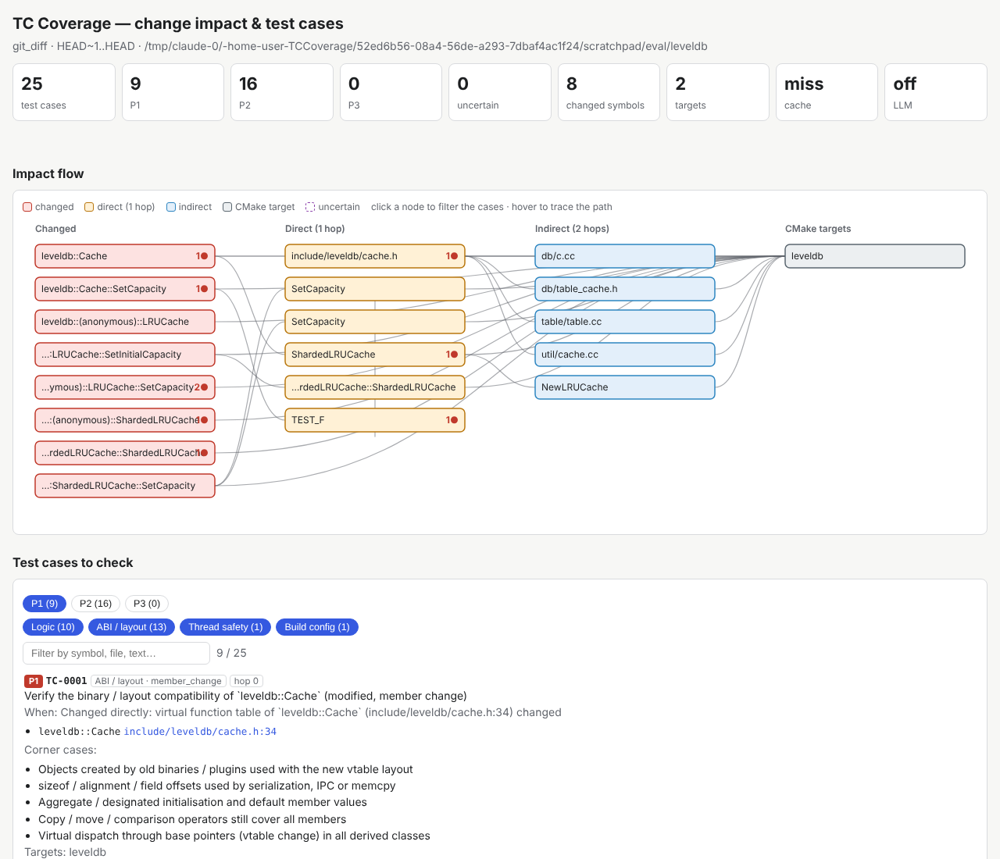

# TCCoverage — Change Impact & Test Case Advisor

For a change in a C/C++ module — built with **CMake** or with **autotools** (`configure.ac` + `Makefile.am`,
e.g. a **Yocto** recipe) — `tcadvisor` tells you **which test cases to check**: the changed symbols, their risk
category (logic, ABI/layout, ownership/lifetime, thread safety, exception safety, build config), every caller /
subclass / user / includer up to N hops, corner cases to exercise, the targets (CMake targets or autotools
programs / libraries) to rebuild/retest, and the blind spots that need manual review. **Linux is the primary
platform** (build hosts, Yocto containers). Results come as Markdown,
JSON, a token-lean brief, and an **interactive HTML impact-flow report**.



**Impact comes from a code graph** (codegraph by default, GitNexus opt-in, or the built-in libclang graph);
**AI only verifies** the deterministic cases and adds corner cases — see [docs/workflow.md](docs/workflow.md)
for the agent/model workflow and the product-development cycle. Real-project evaluation on
google/leveldb: [specs/002…/eval.md](specs/002-graph-providers-ai-verify/eval.md). **Pilot on large projects**
(COVESA vsomeip 133k LOC, RocksDB 898k LOC; 23 real regressions, 0 missed, 87 % at the fixed function):
[specs/003…/pilot.md](specs/003-pilot-large-projects/pilot.md). **Cycle 4** (55 regressions, dev/holdout):
0 missed, 51/55 at the fixed function, MRR ~0.12 → ~0.35, the later-fixed function in the first 10 cases for 26/55
(29/55 with the optional AI-triaged view) —
[specs/004…/results.md](specs/004-ranking-and-recall/results.md).

Two front-ends share the same engine:

| Front-end | Where | Use |
|---|---|---|
| CLI | `tcadvisor analyze …` | CI / pre-submit, scripting |
| AI chat skill | `/tc-coverage HEAD~1..HEAD` in Claude Code or GitHub Copilot (agent mode), installed by `tcadvisor init` | conversational review: the AI filters the cases and answers with concrete test scenarios |

## Quick start (Linux)

```bash
sudo apt install -y python3-venv python3-pip git                 # Debian / Ubuntu build host or Yocto container
python3 -m venv ~/.venvs/tcadvisor
~/.venvs/tcadvisor/bin/pip install "git+https://github.com/cuongngo0806/tccoverage"   # Python >= 3.10, libclang wheel
export PATH="$HOME/.venvs/tcadvisor/bin:$PATH"
npm i -g @colbymchenry/codegraph                                 # the default impact source (MIT; needs Node.js)
cd <your module> && tcadvisor init                               # config + skill for Claude Code and Copilot
git add .tcadvisor/config.json .claude .github && git commit -m "tcadvisor setup"   # else they show up as changes
```

A branch that is not merged yet: `pip install "git+https://github.com/cuongngo0806/tccoverage@<branch>"`.
Updating: `~/.venvs/tcadvisor/bin/pip install -U "git+https://github.com/cuongngo0806/tccoverage"`, then in each
workspace `tcadvisor init --upgrade` (refreshes the skill / agents / prompts to the installed version and adds new
config keys; your config values are kept). `tcadvisor --version` must be 0.2.0 or newer for this guide.
No Node.js on the host: set `"graph": "clang"` in `.tcadvisor/config.json` (built-in graph; needs a compile
database, see below).

Modules built by **Yocto with autotools**: follow [docs/linux-yocto.md](docs/linux-yocto.md) — compile flags come
from the recipe's `log.do_compile`: put its path in `"build_log"` of `.tcadvisor/config.json` (or `tcadvisor init
--build-log <path>`); every analysis turns it into `compile_commands.json`. `tcadvisor profile` confirms the
build variants once so cases on code that no shipped variant builds are listed apart.

`tcadvisor init` writes `.tcadvisor/config.json` (every setting with its default, and the Python interpreter it ran
with), the `tc-coverage` skill (`.claude/skills/` for Claude Code, `.github/skills/` for Copilot), the Claude
subagents (`.claude/agents/`) and the Copilot prompts `/tc-coverage`, `/tc-verify` (`.github/prompts/`).
`--ai claude`, `--ai copilot` or `--ai none` installs fewer; existing files are kept unless `--force`. Then ask your
assistant `/tc-coverage working-tree` (or a commit range).

Reports are written **inside the workspace**, one folder per analysis that later runs never overwrite:
`.tcadvisor/reports/<YYYYMMDD-HHMMSS>-<change>/report.html`, with `.tcadvisor/reports/latest` pointing at the
newest. The folder is ignored through `.git/info/exclude` (no tracked file is touched). Delete old run folders
yourself when you no longer need them.

macOS and Windows: best effort (the Python package and the CMake flow work; the Yocto / autotools guide and the
CI target Linux).

What the report contains by default:

- **No unit-test noise**: unit-test / mock code (paths like `test/`, `unittests/`, `UT_*`, `mock*`, plus
  `test_paths` globs) is left out — no cases for changed tests, test functions calling the change or test files
  including it, no re-run list. `include_tests: true` (or `--include-tests`) brings it back.
- **Only what needs a real test**: with `ai_verify: chat` (the default `tcadvisor init` writes) the skill lets the
  AI verify every case from packed code windows; cases it closes (`not_needed`: a clean build settles it, or the
  change cannot reach that code; `pass_by_review`: proven from the code) move to `report.ai-verified.md` /
  `.html` with the AI's reason. `report.md` / `report.html` keep the cases to test on the real system;
  `report.json` keeps all of them. `ai_verify: claude` makes `tcadvisor analyze` run the same filter headless
  through the Claude Code CLI.

## How it works (deterministic first)

1. **Index** every translation unit of `compile_commands.json` with libclang: functions, classes, macros and
   their `call`, `inherit_override`, `uses_type`, `instantiate`, `macro_expand`, `include` edges. Cached per TU in
   SQLite keyed by content hashes → only changed TUs are re-parsed.
2. **Diff → changed symbols**: each changed file is parsed old/new; symbols are compared on comment-free
   token streams, so comment/format-only edits yield *no detected impact*.
3. **Risk rules** (additive) classify each change; **traversal** walks dependents up to `--max-hop-depth` (2).
4. **Cases** per (impacted node × risk group) with deterministic priority: direct + high-severity = P1,
   direct or high-severity = P2, else P3. Every case carries file:line evidence (evidence gate).
5. **Uncertainty flags**: uninstantiated templates, DI/virtual-only methods, callbacks/function pointers,
   macro branches not compiled in any configuration.
6. Optional local LLM (Ollama) may only reword descriptions; off by default and degrades gracefully.

## Third-party API boundaries

When the analysed module only contains its own code, its libraries are visible as **declarations** only
(headers on the include path of `compile_commands.json`). A changed line that calls such a function gets one
case on the calling function (`sub_reason: external_call`, never propagated to its callers) whose corner cases
come from the declaration and the call site: null pointer return, failure / sentinel return (and whether the
result is ignored), may throw (C++ linkage, not `noexcept`), out-parameters, callbacks, pointer + length pairs.
The call also stays an uncertainty flag: the library's behaviour is not in the graph. Standard-library calls
are only counted in `run_notes`.

Behaviour a declaration cannot show is recorded once, by hand, in `.tcadvisor/external-contracts.json` of the
analysed repo (or `--contracts FILE`); keys are qualified names or `fnmatch` patterns:

```json
{
  "vendor_send": ["returns -EAGAIN when the send queue is full"],
  "vendor::*":   ["not thread-safe: one channel per thread"]
}
```

Matching entries appear as `Contract: ...` corner cases. Nothing leaves the machine; no model is involved.

## Lessons-learned cases

Besides the changed code and its callers, the report points at the *other* code that regressions came from in
practice (spec 006, all deterministic, off with `--no-patterns`):

| Pattern (`pattern`) | Lesson | Case on |
|---|---|---|
| `data_path_emitter` / `_forwarder` | A changed what it produced; B and C were untouched, C forwarded it and sent wrong data | the function that finally sends the data (send / write / publish-like call, third-party API), with the full path A → B → C; forwarders lower |
| `sibling_source` | a function triggered from 4 places was protected in one | every other caller / registered callback without the same guard |
| `symmetric_counterpart` | encode changed, decode not | decode / close / unlock / unregister … |
| `same_code_elsewhere` | the fixed line was copy-pasted | other functions containing it |
| `new_enum_value` | new enumerator fell into `default:` | switch sites over the enum |
| `return_meaning` | new error code treated as success | callers deciding on the result |
| `shared_state` | new value / timing of a member | readers of the member / global |
| `new_early_exit` | new `return` leaked a lock | the changed function (what was acquired before the exit) |
| `config_reader` | setting read differently in two places | other readers of the setting |
| `removed_write` | a flag / counter is no longer set on one path | readers of the member / global (spec 009) |
| `setter_readers` | `SetCount(...)` call dropped | callers of the paired getter (`Count`) |
| `lock_coupling` | lock removed from one accessor | other accessors of the members used under the lock |
| `changed_default` | default of an option / constant changed | readers of that field / constant |
| `class_consumer` | encoder changed, decoder in the same class not | same-class methods reading the members it writes |
| `conditional_write` | condition around a write changed (`%` → `/`, `<` → `<=`, …) | readers of the written field (`->field` too), incl. readers behind trivial accessors (spec 010) |
| `guard_removed_callee` | condition removed / weakened before a call | the callee, now reached in the excluded state |

### Corner cases from the edit itself (spec 009)

Every changed symbol's case lists the concrete inputs the edit makes behave differently, quoting the code:
`left <= right` now also holds when `left == right`; constant `64` → `8`: test 7, 8, 9, 63, 64, 65; removed
condition `snapshot != nullptr`: call with a null snapshot (the case becomes **P1**, `removed_guard`); removed
early exit; return value `Status::Corruption(...)` → `Status::OK()`: feed malformed input; `free(e)` now runs before
a statement using `e`: use after free; a call / assignment / term / lock no longer made; and input classes for the
parameters used on changed lines (null, empty, 0 / max, NaN, ...). Changed symbols that no existing test reaches are
listed as **test gaps** (report, brief `TEST-GAP`, HTML) when `include_tests` is on.

### Test scenarios: one test per flow (spec 013)

Every report starts with **test scenarios**: the cases grouped into runnable tests. Cases on one call path
(`processRxResSig → checkEndF → determineResSuspend`) are one test entered at the outermost caller; cases reached
through the same non-call link of a changed symbol (class members, includers, subclasses) are one representative test.
Each scenario lists the TC ids it covers and its checks once (AI corner cases first, generic hints only when nothing
concrete is left). Markdown shows a Mermaid flow per scenario, the HTML shows cards (flow boxes, covered TCs,
"record for the whole scenario"), the brief starts with `SCENARIO` lines; report.json carries `test_scenarios`. The
per-case list (evidence) follows as "Test case details". On the first field run the 7 cases left to test became 4
scenarios, all 244 cases 59 (`specs/013-test-scenarios/results.md`).

Measured with `scripts/seeded_regressions.py` (31 seeded "fixed here, broke there" edits on leveldb and yaml-cpp; see
`specs/009-side-effect-corner-cases/results.md`, `specs/010-accessor-readers-ci/results.md`). Readers hidden behind
a trivial accessor (`bool Ready() const { return ready_; }`) are reported as the accessor's callers. CI
(`.github/workflows/ci.yml`) runs the suite, the leveldb eval and this benchmark with per-set minimum thresholds
(`--min-victims SET=N`, `--min-corners SET=N`).

Data paths are traced with libclang over the translation units they need (`--flow-max-tus`, default 4,
cached); where a value leaves what can be followed (stored in a member or a container, budget reached) an
uncertainty flag says where. A reason found on code that already has a case is folded into that case.

Team knowledge goes into `.tcadvisor/lessons.json` (or `--lessons FILE`):

```json
{
  "sinks": ["ipc_post*", "Bus::emit"],
  "lessons": [{"id": "L7", "title": "Units", "when": {"tokens_any": ["timeout_ms", "delay"]},
               "ask": "Check every caller passes milliseconds"}]
}
```

`sinks` extend the emitting points of data paths; a lesson whose `when` matches (tokens of the change,
`name_glob`, `path_glob`, `sub_reason`) adds `Lesson L7 (Units): …` to the case.

## Test report (fill in, attach evidence, submit)

`report.html` is also the verification record of the change. Per case: **Pass / Fail / Cannot be tested /
Cannot occur**, comment, tester, date, defect reference and attachments (screenshots, logs, any file —
embedded in the file). Rules: *Cannot be tested* / *Cannot occur* need a justification, *Fail* needs an
attachment or a defect reference. **Save report** writes a new single HTML file with everything inside
**Print / PDF** gives a printable record. Above `--attachment-warn-mb` (50) the
report warns about its size.

```bash
tcadvisor results filled.html            # summary; exit 0 complete, 4 incomplete or any Fail
tcadvisor analyze ... --previous-report filled.html   # after more edits: results carried over by case key,
                                                      # 'needs re-check' where the code behind a case changed
```

Evidence: drop files, pick them, or **paste a screenshot (Ctrl+V)** into a case's evidence box — images show inline
in the case, open full size on click and are printed; the saved report stays one self-contained file.

Each case has a stable `key` (what the case is about, not its position) and a `code_fingerprint`. Every analysis
writes its own run folder, so a filled report is never overwritten; the next analysis carries the results of the
latest run's filled `report.html` over by case key (`--previous-report` picks another one).

## Graph providers and project config

```bash
npm i -g @colbymchenry/codegraph     # MIT — the default source
npm i -g gitnexus                    # optional; PolyForm-Noncommercial license, check before commercial use
tcadvisor analyze ... --graph codegraph|gitnexus|clang --language vi|en
```

`<repo>/.tcadvisor/config.json` holds the workspace settings shared by every way of running the tool — CLI,
Claude Code and GitHub Copilot chat (`tcadvisor init` writes every key with its default; `tcadvisor config` prints
each key, its value and whether it comes from the config file or the default; `--json` for tools). Unknown keys
stop the run and name the closest valid key.

```json
{"graph": "codegraph", "language": "vi", "build_dir": "build", "include_tests": false, "ai_verify": "chat",
 "targets": ["remoteapp"], "verify_model": "haiku", "budget_usd": 0.5, "python": "/home/me/.venvs/tcadvisor/bin/python"}
```

| Key | Default | Meaning |
|---|---|---|
| **core** | | |
| `graph` | `codegraph` | impact source: `codegraph`, `gitnexus` or `clang` |
| `language` | `vi` | report language: `vi` or `en` |
| `build_dir` | `build` | build dir with `compile_commands.json` (CMake: and the File API reply), relative to the repo; autotools: the compile database of the build profile / `compile-db` is used when this is not set |
| `output_dir` | `.tcadvisor/reports` | report root, relative to the repo; one run folder per analysis inside it |
| `targets` | all | CMake targets or autotools products to restrict the scope to |
| `max_hop_depth` | `2` | caller levels to follow |
| `include_tests` | `false` | also analyse unit-test / mock code (`--include-tests`) |
| `test_paths` | `[]` | extra globs of unit-test / mock files, e.g. `["src/**/sim_*"]` |
| `ai_verify` | `off` (`init`: `chat`) | AI filter after each analysis: `off`, `chat` (the skill does it), `claude` (`analyze` runs the headless Claude Code CLI; the setting approves sending packed code windows) |
| **build (spec 012)** | | |
| `build_system` | `auto` | `cmake`, `autotools` or `auto` (`CMakeLists.txt` / `configure.ac` at the repo root) |
| `build_log` | none | build log the compile flags come from: a path (Yocto `${WORKDIR}/temp/log.do_compile`, a `make V=1` / `make -n` log) or `{"<variant>": "<path>", …}`; every analysis regenerates the compile database when the log changed. `init` fills it from `$BUILDDIR` when it can, or `tcadvisor init --build-log <path>` |
| `build_log_src` | none | source dir that build used, when it is not the workspace and auto-mapping fails (Yocto `${S}`) |
| `build` | none | the confirmed build profile (`tcadvisor profile`): variants with their compile database and switch values |
| **analysis** | | |
| `graph_bin` | PATH | codegraph / GitNexus executable |
| `contracts`, `lessons`, `target_patterns` | `.tcadvisor/…` when present | third-party API contracts, team lessons, extra "needs the target" regexes (JSON files) |
| `index` | `auto` | `full` libclang index, `lite` include scan, `auto` = lite with a graph provider |
| `jobs` | CPU count | parallel libclang workers |
| `patterns` / `history` | `true` / `true` | data paths + trigger sources + lesson patterns / bug-fix history ranking |
| `flow_max_tus`, `split_threshold` | `4`, `50` | TUs parsed for data paths; changed symbols above which the run is split |
| `cache_dir` | `<repo>/../.tcadvisor-cache/<repo>` | index cache (outside the repo) |
| `allow_stale_compile_db` | `false` | accept a compile database older than the CMake files |
| **report** | | |
| `format` | `all` | `md`, `json`, `html`, `both` (md+json), `all` |
| `attachment_warn_mb` | `50` | the HTML report warns above this much embedded evidence |
| **AI verification** | | |
| `python` | interpreter of `init` | the Python the skill / agents run `-m tcadvisor` with (e.g. a virtual environment) |
| `claude_bin` | PATH | Claude Code CLI for `ai_verify: claude` / `tcadvisor verify` |
| `verify_model`, `synth_model` | `haiku`, `sonnet` | model per batch / for the single synthesis call |
| `budget_usd` | none | spending cap per model call (`claude --max-budget-usd`) |
| `verify_priorities`, `verify_max_cases`, `verify_parallel` | `P1,P2,P3`, `120`, `4` | which cases are packed, how many, parallel calls |

Precedence: command-line flag > config file > built-in default. With a config, `tcadvisor analyze --working-tree` needs no other argument. The configured source is
**always** the one used: if it is missing or fails, the run stops (exit 1) with the install command; a root the source cannot resolve becomes an uncertainty flag,
it is never traced with another graph. `clang` = the built-in libclang graph (needs compile_commands.json).
codegraph's index is built in `<repo>/.codegraph/` on the first run (`codegraph init`, git-ignored via
`.git/info/exclude`) and synced on later runs, so nothing has to be set up per repo.

`language` selects the report language (Markdown, HTML, brief): `vi` (default) or `en`.
`report.json` keeps the English text as the machine contract and records `report_language`;
`tcadvisor render report.json --language en` re-renders an existing report in the other language.

With a graph provider the libclang index is replaced by a fast `#include` scan (`--index auto|full|lite`),
so ~1M-line code bases analyse in minutes. With codegraph/GitNexus a compile database is optional (results are marked *reduced accuracy* without it);
with it, change classification and CMake target mapping are exact.

## AI verification (optional, explicit opt-in)

```bash
tcadvisor verify .tcadvisor/reports/latest/report.json --ai-external-approved   # verify_model per batch + 1 synth_model call
```

Sends only packed code windows (≤40 lines per impacted symbol) through the Claude Code CLI. Verdicts never delete a
case: `not_needed` / `pass_by_review` move it to `report.ai-verified.*`, `confirmed` / `needs_info` keep it in the
list to test.

## Install

See *Quick start (Linux)*. From a checkout: `python3 -m venv .venv && .venv/bin/pip install -e .` (Python ≥ 3.10,
pulls the libclang wheel; no system clang needed to analyse). The advisor only reads build artefacts, it never
configures or runs your build:

```bash
# CMake
mkdir -p build/.cmake/api/v1/query && touch build/.cmake/api/v1/query/codemodel-v2
cmake -S . -B build -DCMAKE_EXPORT_COMPILE_COMMANDS=ON
# autotools (local build; Yocto: docs/linux-yocto.md)
autoreconf -fi && mkdir -p b && cd b && ../configure && make V=1 2>&1 | tee ../build.log && cd ..
tcadvisor compile-db --repo . --from-log build.log --variant default
```

Cannot build on the host (target-only headers)? `make -n V=1 > dry.log` after `configure` prints every compile
command without compiling; `compile-db --from-log dry.log` reads it. More options: [docs/linux-yocto.md](docs/linux-yocto.md).

## CLI

```bash
tcadvisor analyze --repo /path/repo --commit-range HEAD~1..HEAD [--targets remoteapp,libremote]
                                                     # report: /path/repo/.tcadvisor/reports/<time>-<change>/
tcadvisor analyze ... --working-tree                 # uncommitted changes
tcadvisor analyze ... --symbols rca::RemoteDoorLock::processOrderResp
tcadvisor analyze ... --print brief                  # compact output for AI assistants / PR comments
tcadvisor analyze ... --variants imx8-basic           # only this build variant (profile); --no-variant-filter: none
tcadvisor compile-db --from-log log.do_compile --variant imx8-basic   # autotools / Yocto compile flags
tcadvisor profile [--detect --json | --save FILE|- | --show]          # confirm the build variants
tcadvisor config                                     # every setting, its value and source
tcadvisor render .tcadvisor/reports/latest/report.json   # re-render md/html
tcadvisor cache clear --repo /path/repo
```

Exit codes: 0 ok · 1 prerequisite (compile db / File API missing or stale) · 2 usage · 3 internal.
`--exact-output-dir` writes straight into `--output-dir` without a run folder (scripts, benchmarks).
Outputs: `report.md` (test scenarios + Mermaid flows), `report.json` (schema: `specs/001-change-impact-test-advisor/contracts/output-schema.json`),
`report.html`, `report.brief.txt`; after an AI filter also `report.ai-verified.md` / `.html` (the closed cases).

## Claude Code and GitHub Copilot

`tcadvisor init` installs one `tc-coverage` skill for both (see *Quick start*). In Claude Code run
`/tc-coverage HEAD~1..HEAD`; in Copilot Chat (**Agent** mode) the skill is picked up automatically, or run the
prompt `/tc-coverage working-tree`, and `/tc-verify` to (re-)run only the AI filter. The assistant runs the CLI with
`--print brief`, never traces dependencies itself, verifies the cases from `verify-pack` packets when `ai_verify` is
`chat`, runs `tcadvisor annotate` and answers in the report language with concrete test scenarios. Claude Code can
spread the verification over the `tc-case-verifier` (Haiku) and `tc-verify-synthesizer` (Sonnet) subagents.
Speckit commands for Claude: `/speckit-specify`, `/speckit-plan`, `/speckit-tasks`, `/speckit-implement`, …

## Development

```bash
sudo apt install -y clang cmake autoconf automake libtool make      # test fixtures (CMake + autotools modules)
python3 -m venv .venv && .venv/bin/pip install -e '.[dev]' && .venv/bin/python -m pytest -q
```

Spec-driven docs: `specs/NNN-*/` (spec, plan, tasks, results; Linux / Yocto / autotools: `specs/012-linux-yocto-autotools/`).
Project rules: `.specify/memory/constitution.md`.
