# Báo cáo ảnh hưởng thay đổi & test case

- **Thay đổi**: git_diff — HEAD~1..HEAD
- **Repository**: `/home/worker/honda/nad/LGE/tsu-src/apps/remotecontrolapp`
- **Tóm tắt**: 244 test case [P1 91 / P2 104 / P3 49]; 20 điểm chưa chắc chắn; 6 file thay đổi; target: libremotecontrolapp; dùng lại kết quả cache: có; LLM: tắt; 0.11s

## Symbol bị thay đổi

| Symbol | Thay đổi | Nhóm rủi ro |
|---|---|---|
| `rca::Feature` src/features/Feature.h:269 | bị thay đổi | ABI / layout (thành viên thay đổi), Logic, Sở hữu / vòng đời (pointer thô) |
| `rca::Feature::getIsRecvStopCmd` src/features/Feature.h:463 | bị xoá | ABI / layout (chữ ký thay đổi), Logic |
| `rca::Feature::setIsRecvStopCmd` src/features/Feature.h:478 | bị xoá | ABI / layout (chữ ký thay đổi) |
| `rca::RemoteEngineStart::processOrderResp` src/features/RemoteEngineStart.cpp:60 | bị thay đổi | Logic |
| `rca::RemoteEngineStart::completeFeature` src/features/RemoteEngineStart.cpp:204 | bị thay đổi | Logic |
| `rca::RemoteEngineStart::determineResSuspend` src/features/RemoteEngineStart.cpp:1569 | bị thay đổi | Logic (điều kiện chặn bị xoá) |
| `rca::RemoteEngineStart` src/features/RemoteEngineStart.h:323 | bị thay đổi | ABI / layout (thành viên thay đổi), Cấu hình build (macro), Logic |
| `rca::RemoteEngineStartCancel::processOrderResp` src/features/RemoteEngineStartCancel.cpp:29 | bị thay đổi | Logic |
| `rca::RemoteEngineStartCancel::completeFeature` src/features/RemoteEngineStartCancel.cpp:183 | bị thay đổi | Logic |
| `rca::RemoteEngineStartCancel::processOrderData` src/features/RemoteEngineStartCancel.cpp:213 | bị thay đổi | Logic |
| `rca::RemoteEngineStartCancel::deactiveFeature` src/features/RemoteEngineStartCancel.cpp:640 | bị thay đổi | Logic |

## Luồng ảnh hưởng

Mũi tên đi từ code bị ảnh hưởng tới phần nó phụ thuộc (đỏ = bị thay đổi, cam = trực tiếp, xanh = gián tiếp).

```mermaid
flowchart RL
  n0(["rca::Feature"]):::h0
  n1(["rca::Feature::getIsRecvStopCmd"]):::h0
  n2(["rca::Feature::setIsRecvStopCmd"]):::h0
  n3(["rca::RemoteEngineStart::processOrderResp"]):::h0
  n4(["rca::RemoteEngineStart::completeFeature"]):::h0
  n5(["rca::RemoteEngineStart::determineResSuspend"]):::h0
  n6(["rca::RemoteEngineStart"]):::h0
  n7(["rca::RemoteEngineStartCancel::processOrderResp"]):::h0
  n8(["rca::RemoteEngineStartCancel::completeFeature"]):::h0
  n9(["rca::RemoteEngineStartCancel::processOrderData"]):::h0
  n10(["rca::RemoteEngineStartCancel::deactiveFeature"]):::h0
  n11[/"src/features/Feature.h"/]:::h1
  n12["rca::Feature::Feature"]:::h1
  n13["rca::Feature::onFeatureStateChanged"]:::h1
  n14["rca::Feature::getHandler"]:::h1
  n15["rca::Feature::handleIgStateChanged"]:::h1
  n16["rca::Feature::handleAccStateChanged"]:::h1
  n17["rca::Feature::handlePowerStateChanged"]:::h1
  n18["rca::Feature::handlePowerModeChanged"]:::h1
  n19["rca::Feature::handleFeatureStatusChanged"]:::h1
  n20["rca::Feature::handleMessage"]:::h1
  n21["rca::Feature::getMessageList"]:::h1
  n22["rca::Feature::completeFeature"]:::h1
  n23["rca::Feature::getRemoteControlIfMgr"]:::h1
  n24["rca::Feature::getAppManager"]:::h1
  n25["rca::Feature::getVehicleService"]:::h1
  n26["rca::Feature::getTimerHandler"]:::h1
  n27["rca::Feature::getACCState"]:::h1
  n28["rca::Feature::getIGState"]:::h1
  n29["rca::Feature::getPowerState"]:::h1
  n30["rca::Feature::getEthernetState"]:::h1
  n31["rca::Feature::getPowerMode"]:::h1
  n32["rca::Feature::getIsReqAct"]:::h1
  n33["rca::Feature::getIsReqDeact"]:::h1
  n34["rca::Feature::setHandler"]:::h1
  n35["rca::Feature::setRemoteControlIfMgr"]:::h1
  n36["rca::Feature::setAppManager"]:::h1
  n37["rca::Feature::setVehicleService"]:::h1
  n38["rca::Feature::setTimerHandler"]:::h1
  n39["rca::Feature::setACCState"]:::h1
  n40["rca::Feature::setIGState"]:::h1
  n41["rca::Feature::setPowerState"]:::h1
  n42["rca::Feature::setEthernetStt"]:::h1
  n43["rca::Feature::setPowerMode"]:::h1
  n44["rca::Feature::setIsReqAct"]:::h1
  n45["rca::Feature::setIsReqDeact"]:::h1
  n46["RemoteDoorLock"]:::h1
  n47["RemoteDoorUnlock"]:::h1
  n48["processReplyReq"]:::h1
  n49["checkEndF"]:::h1
  n50["handleMessage"]:::h1
  n51[/"src/features/RemoteEngineStart.h"/]:::h1
  n52["RemoteEngineStart"]:::h1
  n53["rca::RemoteEngineStart::RemoteEngineStart"]:::h1
  n54["processOrderResp"]:::h1
  n55["processReplyReq"]:::h1
  n56["onFeatureStateChanged"]:::h1
  n57["handleMessage"]:::h1
  n58["RemoteEngineStartCancel"]:::h1
  n59["RemoteStartInhibition"]:::h1
  n11 -- include --> n0
  n12 -- contains --> n0
  n13 -- contains --> n0
  n14 -- contains --> n0
  n15 -- contains --> n0
  n16 -- contains --> n0
  n17 -- contains --> n0
  n18 -- contains --> n0
  n19 -- contains --> n0
  n20 -- contains --> n0
  n21 -- contains --> n0
  n22 -- contains --> n0
  n23 -- contains --> n0
  n24 -- contains --> n0
  n25 -- contains --> n0
  n26 -- contains --> n0
  n27 -- contains --> n0
  n28 -- contains --> n0
  n29 -- contains --> n0
  n30 -- contains --> n0
  n31 -- contains --> n0
  n32 -- contains --> n0
  n33 -- contains --> n0
  n34 -- contains --> n0
  n35 -- contains --> n0
  n36 -- contains --> n0
  n37 -- contains --> n0
  n38 -- contains --> n0
  n39 -- contains --> n0
  n40 -- contains --> n0
  n41 -- contains --> n0
  n42 -- contains --> n0
  n43 -- contains --> n0
  n44 -- contains --> n0
  n45 -- contains --> n0
  n46 -- inherit_override --> n0
  n47 -- inherit_override --> n0
  n48 -- call --> n4
  n49 -- call --> n5
  n50 -- call --> n3
  n51 -- include --> n6
  n52 -- inherit_override --> n0
  n53 -- contains --> n6
  n54 -- call --> n9
  n55 -- call --> n8
  n55 -- call --> n9
  n56 -- call --> n10
  n57 -- call --> n7
  n58 -- inherit_override --> n0
  n59 -- inherit_override --> n0
  classDef h0 fill:#fde2e1,stroke:#c0392b,color:#000
  classDef h1 fill:#fff1d6,stroke:#d68910,color:#000
  classDef h2 fill:#e8f1fb,stroke:#2e86c1,color:#000
  more["+66 node nữa (xem report.html)"]
```

## Test case cần kiểm tra

Kế hoạch test: 7 test trên target, 0 cần review (đọc code có thể đóng), 237 đã được AI đóng (liệt kê trong report.ai-verified.md).

- **Test trên target**: rủi ro chỉ lộ ra khi chạy trên thiết bị (đồng thời, vòng đời bộ nhớ, layout dữ liệu, cấu hình build, code phần cứng / interrupt / timing / RTOS / bus), hoặc AI reviewer đã đọc code mà không đóng được.
- **Review code**: không có tín hiệu lúc chạy — đọc code có thể đóng case mà không cần chạy (`tcadvisor verify --scope review`); nếu không ai đóng được thì test trên target.
- **AI đã đóng**: AI reviewer đã chứng minh từ code rằng case không thể lỗi, hoặc đánh giá rằng không cần test thực tế (chỉ cần build lại là đủ); các case này được liệt kê trong report.ai-verified.md / .html kèm lý do của AI, để quyết định vẫn kiểm tra lại được.

Trong mỗi nhóm: xếp theo độ liên quan (gần thay đổi nhất, thay đổi thực chất trước thay đổi chỉ cần biên dịch lại, thay đổi lớn trước); nhãn P1/P2/P3 là mức ưu tiên tất định.

### Test trên target (7)

#### Test trên target — code bị thay đổi (4)

- [ ] **TC-0001** P1 [Logic] Kiểm tra hành vi chức năng của `rca::RemoteEngineStart::determineResSuspend` (bị thay đổi, điều kiện chặn bị xoá)
  - *Khi nào*: Thay đổi trực tiếp: điều kiện bị xoá trong `rca::RemoteEngineStart::determineResSuspend` (src/features/RemoteEngineStart.cpp:1569): `if (!isRecvStartCmd \|\| isRecvStopCmd) {`; `if (!privacy) {`
  - *Bằng chứng*: `rca::RemoteEngineStart::determineResSuspend` (src/features/RemoteEngineStart.cpp:1569)
  - *Corner case*: Đã bỏ điều kiện `!isRecvStartCmd || isRecvStopCmd`: code mà nó bảo vệ giờ cũng chạy khi điều kiện đó sai — làm cho `isRecvStartCmd || isRecvStopCmd` đúng; Đã bỏ điều kiện `!privacy`: code mà nó bảo vệ giờ cũng chạy khi điều kiện đó sai — làm cho `privacy` là true / khác null; `CommImpl::isPrivacyOn(…)` không còn được gọi ở đây (`bool privacy = CommImpl::isPrivacyOn(PPP_SERID_RES);`): mọi thứ phụ thuộc vào tác dụng của nó (trạng thái, bộ đếm, thông báo, dọn dẹp) vẫn phải đúng; `LOG_I(…)` không còn được gọi ở đây (`LOG_I(DLT_STRING("Privacy Setting is OFF"));`): mọi thứ phụ thuộc vào tác dụng của nó (trạng thái, bộ đếm, thông báo, dọn dẹp) vẫn phải đúng; `isRecvStartCmd = false;` không còn được thực hiện ở đây: các nơi đọc `isRecvStartCmd` không được dựa vào việc nó được cập nhật trên đường đi này
  - *Target*: libremotecontrolapp
  - *AI kiểm tra*: **xác nhận: cần test thực tế** — kiểm tra lại: Bỏ guard isRecvStartCmd và check privacy PPP_SERID_RES: auto-stop giờ chạy khi chưa có lệnh start và luôn gửi report GTC dù privacy OFF.
  - *Corner case từ AI*: Privacy RES = OFF, động cơ tự dừng (isDuring!=0 && isResSuspenNoDa): xác nhận có/không gửi report GTC (trước đây không gửi); Khởi động lại RCA khi MEMORY_RES_DURING còn khác 0 (chưa nhận lệnh start trong phiên này): auto-stop có được phát hiện đúng 1 lần, MEMORY_RES_DURING về 0; isRecvStopCmd=true + RESC==OFF + MEMORY_RES_DURING!=0: cờ được xoá, log 'clear stop cmd flag', auto-stop chạy cùng chu kỳ; isRecvStopCmd=true + RESC==ON: cờ giữ nguyên, không phát hiện auto-stop trong lúc RESC đang chạy; isRecvStopCmd=true + RESC==OFF + MEMORY_RES_DURING==0: cờ không bị xoá, không gửi report; lệnh start sau đó vẫn chạy bình thường; getFeatureStatus(RESC)==OFF nhưng RESC đang chờ kích hoạt (isReqAct, priority pending): cờ bị xoá sớm, kiểm tra không gửi trùng report auto-stop và reply RESC
- [ ] **TC-0005** P2 [Logic] Kiểm tra hành vi chức năng của `rca::RemoteEngineStart::processOrderResp` (bị thay đổi)
  - *Khi nào*: Thay đổi trực tiếp: luồng điều khiển / phép tính bị thay đổi trong `rca::RemoteEngineStart::processOrderResp` (src/features/RemoteEngineStart.cpp:60): `true`
  - *Bằng chứng*: `rca::RemoteEngineStart::processOrderResp` (src/features/RemoteEngineStart.cpp:60)
  - *Corner case*: `isRecvStartCmd = true;` không còn được thực hiện ở đây: các nơi đọc `isRecvStartCmd` không được dựa vào việc nó được cập nhật trên đường đi này; Chạy qua mọi nhánh có điều kiện bị thay đổi (cả nhánh true và false); Giá trị biên quanh các phép so sánh và giới hạn vòng lặp đã thay đổi (min, max, lệch một); Các đường đi lỗi / return sớm và case default của switch
  - *Target*: libremotecontrolapp
  - *AI kiểm tra*: **xác nhận: cần test thực tế** — kiểm tra lại: RES processOrderResp giờ đặt isRecvStopCmd=true khi nhận CMD_RES_STOP và không còn đặt isRecvStartCmd; cần test trên thiết bị.
  - *Corner case từ AI*: Gửi lệnh RES stop khi RES đang chạy rồi RESC thực hiện dừng thành công: cờ được reset ở completeFeature; Gửi lệnh RES stop khi RESC thất bại (W001/W003): cờ không kẹt, auto-stop phát hiện lại được; Gửi lệnh RES stop khi MEMORY_RES_DURING==0 rồi gửi RES start: cờ không chặn auto-stop của phiên mới; Lệnh RES setting/start sau stop: không còn dấu hiệu isRecvStartCmd, kiểm tra luồng start vẫn đủ
- [ ] **TC-0006** P2 [Logic] Kiểm tra hành vi chức năng của `rca::RemoteEngineStart::completeFeature` (bị thay đổi)
  - *Khi nào*: Thay đổi trực tiếp: luồng điều khiển / phép tính bị thay đổi trong `rca::RemoteEngineStart::completeFeature` (src/features/RemoteEngineStart.cpp:204): `false`
  - *Bằng chứng*: `rca::RemoteEngineStart::completeFeature` (src/features/RemoteEngineStart.cpp:204)
  - *Corner case*: `isRecvStartCmd = false;` không còn được thực hiện ở đây: các nơi đọc `isRecvStartCmd` không được dựa vào việc nó được cập nhật trên đường đi này; Chạy qua mọi nhánh có điều kiện bị thay đổi (cả nhánh true và false); Giá trị biên quanh các phép so sánh và giới hạn vòng lặp đã thay đổi (min, max, lệch một); Các đường đi lỗi / return sớm và case default của switch
  - *Target*: libremotecontrolapp
  - *AI kiểm tra*: **xác nhận: cần test thực tế** — kiểm tra lại: RES completeFeature không còn reset isRecvStartCmd (biến đã bỏ) và vẫn reset isRecvStopCmd; ảnh hưởng nhánh RES_DURING/IDLE cần test.
  - *Corner case từ AI*: completeFeature khi MEMORY_RES_DURING!=0: state RES_DURING, isRecvStopCmd=false; completeFeature khi MEMORY_RES_DURING==0: isSentExtendCmd=false, state RES_IDLE; completeFeature giữa lúc RESC đang xử lý lệnh stop: cờ bị reset sớm có làm auto-stop báo trùng không
- [ ] **TC-0012** P2 [Logic] Kiểm tra hành vi chức năng của `rca::RemoteEngineStart` (bị thay đổi)
  - *Khi nào*: Thay đổi trực tiếp: luồng điều khiển / phép tính bị thay đổi trong `rca::RemoteEngineStart` (src/features/RemoteEngineStart.h:323): `false`
  - *Bằng chứng*: `rca::RemoteEngineStart` (src/features/RemoteEngineStart.h:323)
  - *Corner case*: Chạy qua mọi nhánh có điều kiện bị thay đổi (cả nhánh true và false); Giá trị biên quanh các phép so sánh và giới hạn vòng lặp đã thay đổi (min, max, lệch một); Các đường đi lỗi / return sớm và case default của switch
  - *Target*: (không có CMake target nào sở hữu file này)
  - *Cần target vì*: phụ thuộc chỉ xác định lúc chạy (build_config_incomplete_macro): thay đổi trong src/features/RemoteEngineStart.h:323 được bao bởi `#ifndef ENGINE_START_FEATURE_H`; `ENGINE_START_FEATURE_H` không được định nghĩa ở bất kỳ lệnh biên dịch nào, nên nhánh này chưa bao giờ được phân tích (các cấu hình trong compile_commands.json: Debug)
  - *AI kiểm tra*: **xác nhận: cần test thực tế** — kiểm tra lại: Lớp RemoteEngineStart: thêm isRecvStopCmd, bỏ isRecvStartCmd; hành vi runtime đổi ở determineResSuspend/processOrderResp.
  - *Corner case từ AI*: Khởi tạo RES mới: isRecvStopCmd=false mặc định; Chuỗi start -> stop -> start liên tiếp: cờ không rò sang phiên sau

#### Test trên target — ảnh hưởng trực tiếp (2)

- [ ] **TC-0017** P2 [Logic] Kiểm tra lại hành vi chức năng của `handleMessage`, vì nó gọi `rca::RemoteEngineStart::processOrderResp` (trực tiếp)
  - *Khi nào*: Đi tới được từ `rca::RemoteEngineStart::processOrderResp` đã thay đổi: luồng điều khiển / phép tính bị thay đổi trong `rca::RemoteEngineStart::processOrderResp` (src/features/RemoteEngineStart.cpp:60): `true`
  - *Bằng chứng*: `handleMessage` (src/features/RemoteEngineStart.cpp:2756); handleMessage —call→ rca::RemoteEngineStart::processOrderResp (src/features/RemoteEngineStart.cpp:2761)
  - *Corner case*: `isRecvStartCmd = true;` không còn được thực hiện ở đây: các nơi đọc `isRecvStartCmd` không được dựa vào việc nó được cập nhật trên đường đi này; Chạy qua mọi nhánh có điều kiện bị thay đổi (cả nhánh true và false); Giá trị biên quanh các phép so sánh và giới hạn vòng lặp đã thay đổi (min, max, lệch một); Các đường đi lỗi / return sớm và case default của switch
  - *Target*: libremotecontrolapp
  - *Cần target vì*: I/O bus / mạng: `CAN_TYPE_GEN2P` tại src/features/RemoteEngineStart.cpp:2770
  - *AI kiểm tra*: **xác nhận: cần test thực tế** — kiểm tra lại: handleMessage RES chuyển MSG_ORDER_REMOTE_ENGINE vào processOrderResp (nay đặt isRecvStopCmd); cả RES và RESC cùng nhận lệnh stop.
  - *Corner case từ AI*: Lệnh stop đến RES và RESC cùng lúc: thứ tự xử lý RES (đặt cờ) trước/sau RESC (kích hoạt) không làm mất/kẹt cờ; Lệnh stop khi RES không hoạt động: cờ đặt nhưng được dọn ở lần sau
- [ ] **TC-0018** P2 [Logic] Kiểm tra lại hành vi chức năng của `checkEndF`, vì nó gọi `rca::RemoteEngineStart::determineResSuspend` (trực tiếp) — điều kiện chặn bị xoá
  - *Khi nào*: Đi tới được từ `rca::RemoteEngineStart::determineResSuspend` đã thay đổi: điều kiện bị xoá trong `rca::RemoteEngineStart::determineResSuspend` (src/features/RemoteEngineStart.cpp:1569): `if (!isRecvStartCmd \|\| isRecvStopCmd) {`; `if (!privacy) {`
  - *Bằng chứng*: `checkEndF` (src/features/RemoteEngineStart.cpp:708); checkEndF —call→ rca::RemoteEngineStart::determineResSuspend (src/features/RemoteEngineStart.cpp:718)
  - *Corner case*: Đã bỏ điều kiện `!isRecvStartCmd || isRecvStopCmd`: code mà nó bảo vệ giờ cũng chạy khi điều kiện đó sai — làm cho `isRecvStartCmd || isRecvStopCmd` đúng; Đã bỏ điều kiện `!privacy`: code mà nó bảo vệ giờ cũng chạy khi điều kiện đó sai — làm cho `privacy` là true / khác null; `CommImpl::isPrivacyOn(…)` không còn được gọi ở đây (`bool privacy = CommImpl::isPrivacyOn(PPP_SERID_RES);`): mọi thứ phụ thuộc vào tác dụng của nó (trạng thái, bộ đếm, thông báo, dọn dẹp) vẫn phải đúng; `LOG_I(…)` không còn được gọi ở đây (`LOG_I(DLT_STRING("Privacy Setting is OFF"));`): mọi thứ phụ thuộc vào tác dụng của nó (trạng thái, bộ đếm, thông báo, dọn dẹp) vẫn phải đúng; `isRecvStartCmd = false;` không còn được thực hiện ở đây: các nơi đọc `isRecvStartCmd` không được dựa vào việc nó được cập nhật trên đường đi này
  - *Target*: libremotecontrolapp
  - *AI kiểm tra*: **xác nhận: cần test thực tế** — kiểm tra lại: checkEndF gọi determineResSuspend mỗi chu kỳ cntExsSig; thứ tự checkResResult/checkExtresFrCon trước đó với logic mới cần test.
  - *Corner case từ AI*: Chu kỳ checkEndF liên tiếp khi cờ đã bị xoá: auto-stop chỉ phát hiện một lần; ResExtTimer còn thời gian (>0): không phát hiện auto-stop dù cờ đã xoá

#### Test trên target — ảnh hưởng gián tiếp (1)

- [ ] **TC-0153** P3 [Logic] Kiểm tra lại hành vi chức năng của `processRxResSig`, vì nó gọi `checkEndF` (gián tiếp, 2 hop) — điều kiện chặn bị xoá
  - *Khi nào*: Đi tới được từ `rca::RemoteEngineStart::determineResSuspend` đã thay đổi: điều kiện bị xoá trong `rca::RemoteEngineStart::determineResSuspend` (src/features/RemoteEngineStart.cpp:1569): `if (!isRecvStartCmd \|\| isRecvStopCmd) {`; `if (!privacy) {`
  - *Bằng chứng*: `processRxResSig` (src/features/RemoteEngineStart.cpp:817); processRxResSig —call→ checkEndF (src/features/RemoteEngineStart.cpp:990)
  - *Corner case*: Đã bỏ điều kiện `!isRecvStartCmd || isRecvStopCmd`: code mà nó bảo vệ giờ cũng chạy khi điều kiện đó sai — làm cho `isRecvStartCmd || isRecvStopCmd` đúng; Đã bỏ điều kiện `!privacy`: code mà nó bảo vệ giờ cũng chạy khi điều kiện đó sai — làm cho `privacy` là true / khác null; `CommImpl::isPrivacyOn(…)` không còn được gọi ở đây (`bool privacy = CommImpl::isPrivacyOn(PPP_SERID_RES);`): mọi thứ phụ thuộc vào tác dụng của nó (trạng thái, bộ đếm, thông báo, dọn dẹp) vẫn phải đúng; `LOG_I(…)` không còn được gọi ở đây (`LOG_I(DLT_STRING("Privacy Setting is OFF"));`): mọi thứ phụ thuộc vào tác dụng của nó (trạng thái, bộ đếm, thông báo, dọn dẹp) vẫn phải đúng; `isRecvStartCmd = false;` không còn được thực hiện ở đây: các nơi đọc `isRecvStartCmd` không được dựa vào việc nó được cập nhật trên đường đi này
  - *Target*: libremotecontrolapp
  - *Cần target vì*: I/O bus / mạng: `CAN_TYPE_GEN2P` tại src/features/RemoteEngineStart.cpp:825
  - *AI kiểm tra*: **xác nhận: cần test thực tế** — kiểm tra lại: processRxResSig (nơi gọi chuỗi tới determineResSuspend) bị ảnh hưởng bởi guard mới; test cùng kịch bản TC-0001/0018.
  - *Corner case từ AI*: Tín hiệu RES rx liên tục trong lúc cờ isRecvStopCmd chuyển true->false: không phát hiện auto-stop hai lần

## Kiểm tra bằng AI

Cần test trên thiết bị: determineResSuspend (cờ isRecvStopCmd mới, bỏ guard isRecvStartCmd, bỏ check privacy khi gửi report auto-stop) cùng processOrderResp/completeFeature của RES. Phần còn lại là nhiễu do bỏ một bool khỏi Feature và dọn cờ chết ở RESC: build sạch là đủ.

- số case đã kiểm tra: 244; model: claude-sonnet-5-5
- [ ] **Kiểm tra thêm** (AI): Report auto-stop gửi GTC không còn kiểm tra privacy — Trước: chỉ gửi khi CommImpl::isPrivacyOn(PPP_SERID_RES); nay luôn gọi processSendReq. Cần xác nhận đây là chủ ý (spec/PPP). (src/features/RemoteEngineStart.cpp:1599)
- [ ] **Kiểm tra thêm** (AI): Cờ bị xoá sớm khi RESC đang chờ kích hoạt — RESC==OFF trong lúc order stop đang đợi priority; điều kiện xoá cờ dùng đúng trạng thái này nên auto-stop có thể chạy song song với stop do RESC. (src/features/RemoteEngineStart.cpp:1573)
- [ ] **Kiểm tra thêm** (AI): Cờ stop kẹt khi MEMORY_RES_DURING==0 — Guard xoá cờ yêu cầu MEMORY_RES_DURING!=0; chỉ completeFeature mới reset khi đã về 0. (src/features/RemoteEngineStart.cpp:84)
- [ ] **Kiểm tra thêm** (AI): Unit test bị xoá/giảm — UT_GMOCK_Feature.cpp bỏ 143 dòng và UT RemoteEngineStart bỏ 7 dòng; chưa có UT mới cho nhánh xoá cờ trong determineResSuspend. (unittests/testscripts/UT_GMOCK_RemoteEngineStart.cpp:4907)

## Mỗi hàm bị thay đổi được kích hoạt từ đâu

Cần chạy qua mọi nguồn: một bản sửa chỉ được kiểm tra từ một nguồn là lỗi bỏ sót kinh điển.

| Hàm bị thay đổi | Nguồn (caller) | Điểm vào phía sau |
|---|---|---|
| `rca::RemoteEngineStart::processOrderResp` | `handleMessage` src/features/RemoteEngineStart.cpp:2761 | `TEST_F` |
| `rca::RemoteEngineStart::completeFeature` | `processReplyReq` src/features/RemoteEngineStart.cpp:169 | `TEST_F`, `activeFeature`, `checkAcSetting`, `checkDrLockStt`, `checkEndF`, `+9 more` |
| `rca::RemoteEngineStart::determineResSuspend` | `checkEndF` src/features/RemoteEngineStart.cpp:718 | `TEST_F`, `handleMessage` |
| `rca::RemoteEngineStartCancel::processOrderResp` | `handleMessage` src/features/RemoteEngineStartCancel.cpp:728 | `TEST_F` |
| `rca::RemoteEngineStartCancel::completeFeature` | `processReplyReq` src/features/RemoteEngineStartCancel.cpp:147 | `TEST_F`, `determineResStop`, `handleMessage`, `onFeatureStateChanged`, `processOrderResp` |
| `rca::RemoteEngineStartCancel::processOrderData` | `processOrderResp` src/features/RemoteEngineStartCancel.cpp:57 | `TEST_F` |
| `rca::RemoteEngineStartCancel::processOrderData` | `processReplyReq` src/features/RemoteEngineStartCancel.cpp:179 | `TEST_F`, `determineResStop`, `handleMessage`, `onFeatureStateChanged`, `processOrderResp` |
| `rca::RemoteEngineStartCancel::deactiveFeature` | `onFeatureStateChanged` src/features/RemoteEngineStartCancel.cpp:678 | `TEST_F` |

## Chưa chắc chắn — cần review thủ công

| Loại | Symbol | Lý do |
|---|---|---|
| build_config_incomplete_macro | `rca::RemoteEngineStart` src/features/RemoteEngineStart.h:323 | thay đổi trong src/features/RemoteEngineStart.h:323 được bao bởi `#ifndef ENGINE_START_FEATURE_H`; `ENGINE_START_FEATURE_H` không được định nghĩa ở bất kỳ lệnh biên dịch nào, nên nhánh này chưa bao giờ được phân tích (các cấu hình trong compile_commands.json: Debug) |
| build_config_incomplete_macro | `src/features/FeatureFactory.h` src/features/FeatureFactory.h:7 | src/features/FeatureFactory.h:7 nằm trong `#ifndef EE_ARCH_GEN3`, điều kiện không đánh giá được cho (các) biến thể default (không biết giá trị macro); case vẫn được giữ |
| build_config_incomplete_macro | `src/features/RemoteDoorLock.h` src/features/RemoteDoorLock.h:19 | src/features/RemoteDoorLock.h:19 nằm trong `#ifndef RDL_FEATURE_H`, điều kiện không đánh giá được cho (các) biến thể default (không biết giá trị macro); case vẫn được giữ |
| build_config_incomplete_macro | `src/features/RemoteDoorLock.h` src/features/RemoteDoorLock.h:39 | src/features/RemoteDoorLock.h:39 nằm trong `#ifndef RDL_FEATURE_H`, điều kiện không đánh giá được cho (các) biến thể default (không biết giá trị macro); case vẫn được giữ |
| build_config_incomplete_macro | `src/features/RemoteDoorUnlock.h` src/features/RemoteDoorUnlock.h:19 | src/features/RemoteDoorUnlock.h:19 nằm trong `#ifndef RDU_FEATURE_H`, điều kiện không đánh giá được cho (các) biến thể default (không biết giá trị macro); case vẫn được giữ |
| build_config_incomplete_macro | `src/features/RemoteDoorUnlock.h` src/features/RemoteDoorUnlock.h:39 | src/features/RemoteDoorUnlock.h:39 nằm trong `#ifndef RDU_FEATURE_H`, điều kiện không đánh giá được cho (các) biến thể default (không biết giá trị macro); case vẫn được giữ |
| build_config_incomplete_macro | `src/features/RemoteEngineStart.h` src/features/RemoteEngineStart.h:323 | src/features/RemoteEngineStart.h:323 nằm trong `#ifndef ENGINE_START_FEATURE_H`, điều kiện không đánh giá được cho (các) biến thể default (không biết giá trị macro); case vẫn được giữ |
| build_config_incomplete_macro | `src/features/RemoteEngineStart.h` src/features/RemoteEngineStart.h:326 | src/features/RemoteEngineStart.h:326 nằm trong `#ifndef ENGINE_START_FEATURE_H`, điều kiện không đánh giá được cho (các) biến thể default (không biết giá trị macro); case vẫn được giữ |
| build_config_incomplete_macro | `src/features/RemoteEngineStart.h` src/features/RemoteEngineStart.h:339 | src/features/RemoteEngineStart.h:339 nằm trong `#ifndef ENGINE_START_FEATURE_H`, điều kiện không đánh giá được cho (các) biến thể default (không biết giá trị macro); case vẫn được giữ |
| build_config_incomplete_macro | `src/features/RemoteEngineStartCancel.h` src/features/RemoteEngineStartCancel.h:20 | src/features/RemoteEngineStartCancel.h:20 nằm trong `#ifndef ENGINE_START_CANCEL_FEATURE_H`, điều kiện không đánh giá được cho (các) biến thể default (không biết giá trị macro); case vẫn được giữ |
| build_config_incomplete_macro | `src/features/RemoteEngineStartCancel.h` src/features/RemoteEngineStartCancel.h:40 | src/features/RemoteEngineStartCancel.h:40 nằm trong `#ifndef ENGINE_START_CANCEL_FEATURE_H`, điều kiện không đánh giá được cho (các) biến thể default (không biết giá trị macro); case vẫn được giữ |
| build_config_incomplete_macro | `src/features/RemoteStartInhibition.h` src/features/RemoteStartInhibition.h:20 | src/features/RemoteStartInhibition.h:20 nằm trong `#ifndef REMOTE_START_INHIBITION_H`, điều kiện không đánh giá được cho (các) biến thể default (không biết giá trị macro); case vẫn được giữ |
| build_config_incomplete_macro | `src/features/RemoteStartInhibition.h` src/features/RemoteStartInhibition.h:98 | src/features/RemoteStartInhibition.h:98 nằm trong `#ifndef REMOTE_START_INHIBITION_H`, điều kiện không đánh giá được cho (các) biến thể default (không biết giá trị macro); case vẫn được giữ |
| build_config_incomplete_macro | `src/features/ShoulderTapFeature.h` src/features/ShoulderTapFeature.h:19 | src/features/ShoulderTapFeature.h:19 nằm trong `#ifndef SHOULDER_TAP_FEATURE_H`, điều kiện không đánh giá được cho (các) biến thể default (không biết giá trị macro); case vẫn được giữ |
| build_config_incomplete_macro | `src/features/ShoulderTapFeature.h` src/features/ShoulderTapFeature.h:28 | src/features/ShoulderTapFeature.h:28 nằm trong `#ifndef SHOULDER_TAP_FEATURE_H`, điều kiện không đánh giá được cho (các) biến thể default (không biết giá trị macro); case vẫn được giữ |
| build_config_incomplete_macro | `src/features/ShoulderTapForGW.h` src/features/ShoulderTapForGW.h:20 | src/features/ShoulderTapForGW.h:20 nằm trong `#ifndef SHOULDER_TAP_FOR_GW_H`, điều kiện không đánh giá được cho (các) biến thể default (không biết giá trị macro); case vẫn được giữ |
| build_config_incomplete_macro | `src/features/ShoulderTapForGW.h` src/features/ShoulderTapForGW.h:50 | src/features/ShoulderTapForGW.h:50 nằm trong `#ifndef SHOULDER_TAP_FOR_GW_H`, điều kiện không đánh giá được cho (các) biến thể default (không biết giá trị macro); case vẫn được giữ |
| build_config_incomplete_macro | `src/prioritymanager/FeaturePriorityManager.h` src/prioritymanager/FeaturePriorityManager.h:70 | src/prioritymanager/FeaturePriorityManager.h:70 nằm trong `#ifndef FEATUREPRIORITYMANAGER_H`, điều kiện không đánh giá được cho (các) biến thể default (không biết giá trị macro); case vẫn được giữ |
| build_config_incomplete_macro | `src/tidl-generated/remotecontrolapp.h` src/tidl-generated/remotecontrolapp.h:31 | src/tidl-generated/remotecontrolapp.h:31 nằm trong `#ifndef _REMOTE_CONTROL_APPLICATION_H_`, điều kiện không đánh giá được cho (các) biến thể default (không biết giá trị macro); case vẫn được giữ |
| build_config_incomplete_macro | `src/tidl-generated/remotecontrolexecutor.h` src/tidl-generated/remotecontrolexecutor.h:23 | src/tidl-generated/remotecontrolexecutor.h:23 nằm trong `#ifndef _REMOTE_CONTROL_EXECUTOR_H_`, điều kiện không đánh giá được cho (các) biến thể default (không biết giá trị macro); case vẫn được giữ |

## Phạm vi build / test cần chạy lại

- `libremotecontrolapp` — biên dịch file bị ảnh hưởng

## Bỏ qua (ngoài phạm vi)

- `unittests/testscripts/UT_GMOCK_Feature.cpp` `unittests/testscripts/UT_GMOCK_Feature.cpp`: code unit test: không phân tích (include_tests đang tắt)

## Ghi chú lần chạy

- đã đồng bộ index codegraph tại /home/worker/honda/nad/LGE/tsu-src/apps/remotecontrolapp/.codegraph
- đã bỏ qua code unit test (include_tests đang tắt): 1 symbol thay đổi, 268 hàm / file test bị ảnh hưởng

## Số liệu

- run_id: `5f763a54-f965-4430-a109-6f7aa5d289bb`
- thời gian chạy: 0.11s
- cache_hit: True
- index: {'tus': 0, 'reparsed': 0, 'reused': 0, 'lite_files': 102, 'lite_includes': 217}
- LLM: enabled=False degraded=False tokens=None
