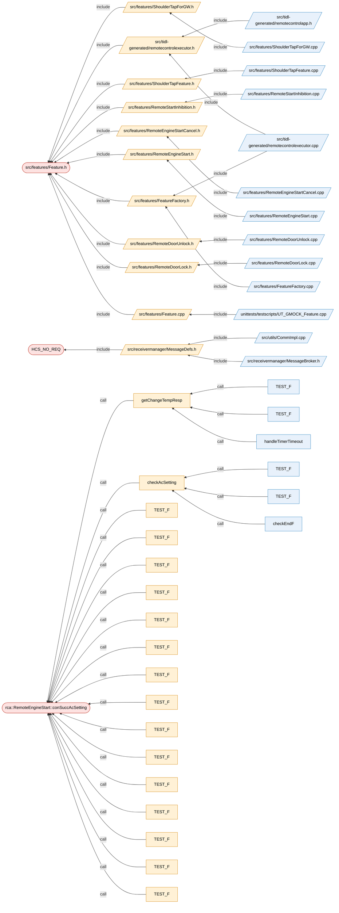

# Báo cáo ảnh hưởng thay đổi & test case

- **Thay đổi**: git_diff — HEAD~1..HEAD
- **Repository**: `D:\Honda\sourceCode\honda_con_release\remotecontrolapp`
- **Tóm tắt**: 79 test case [P1 1 / P2 51 / P3 27]; 1 điểm chưa chắc chắn; 3 file thay đổi; target: -; cache_hit: false; LLM: tắt; 6.436s

## Symbol bị thay đổi

| Symbol | Thay đổi | Nhóm rủi ro |
|---|---|---|
| `src/features/Feature.h` src/features/Feature.h:131 | file | ABI / layout (header_change) |
| `rca::RemoteEngineStart::conSuccAcSetting` src/features/RemoteEngineStart.cpp:1159 | bị thay đổi | Cấu hình build (macro), Logic |
| `HCS_NO_REQ` src/receivermanager/MessageDefs.h:516 | bị xoá | ABI / layout (signature_change), Cấu hình build (macro), Logic |

## Luồng ảnh hưởng

Mũi tên đi từ code bị ảnh hưởng tới phần nó phụ thuộc (đỏ = bị thay đổi, cam = trực tiếp, xanh = gián tiếp).

## Test case cần kiểm tra

Kế hoạch test: 63 test trên target, 16 cần review (đọc code có thể đóng), 0 đã đóng bằng review code.

- **Test trên target**: rủi ro chỉ lộ ra khi chạy trên thiết bị (đồng thời, vòng đời bộ nhớ, layout dữ liệu, cấu hình build, code phần cứng / interrupt / timing / RTOS / bus), hoặc AI reviewer đã đọc code mà không đóng được.
- **Review code**: không có tín hiệu lúc chạy — đọc code có thể đóng case mà không cần chạy (`tcadvisor verify --scope review`); nếu không ai đóng được thì test trên target.
- **Đã đóng bằng review code**: AI reviewer đã chứng minh từ code rằng case không thể lỗi (bằng chứng file:dòng); vẫn liệt kê để quyết định có thể kiểm tra lại.

Trong mỗi nhóm: xếp theo độ liên quan (gần thay đổi nhất, thay đổi thực chất trước thay đổi chỉ cần biên dịch lại, thay đổi lớn trước); nhãn P1/P2/P3 là mức ưu tiên tất định.

### Test trên target (63)

#### Test trên target — code bị thay đổi (6)

- [ ] **TC-0001** P2 [Logic] Kiểm tra hành vi chức năng của `rca::RemoteEngineStart::conSuccAcSetting` (bị thay đổi)
  - *Khi nào*: Thay đổi trực tiếp: luồng điều khiển / phép tính bị thay đổi trong `rca::RemoteEngineStart::conSuccAcSetting` (src/features/RemoteEngineStart.cpp:1159): `!=`, `:`, `?`
  - *Bằng chứng*: `rca::RemoteEngineStart::conSuccAcSetting` (src/features/RemoteEngineStart.cpp:1159)
  - *Corner case*: `seatHeaterRrLsideSetting` giờ nhận `mapHCS.find(rxSigAC[RX_C_HCSRR_RES_HCS_L_GW]) != mapHCS.end(` (trước là `mapHCS.at(rxSigAC[RX_C_HCSRR_RES_HCS_L_GW])`): kiểm tra code dựa vào giá trị cũ của `seatHeaterRrLsideSetting` (giới hạn, kích thước, timeout, flag); `seatHeaterRrRsideSetting` giờ nhận `mapHCS.find(rxSigAC[RX_C_HCSRR_RES_HCS_R_GW]) != mapHCS.end(` (trước là `mapHCS.at(rxSigAC[RX_C_HCSRR_RES_HCS_R_GW])`): kiểm tra code dựa vào giá trị cũ của `seatHeaterRrRsideSetting` (giới hạn, kích thước, timeout, flag); Chạy qua mọi nhánh có điều kiện bị thay đổi (cả nhánh true và false); Giá trị biên quanh các phép so sánh và giới hạn vòng lặp đã thay đổi (min, max, lệch một); Các đường đi lỗi / return sớm và case default của switch
  - *Target*: (không có CMake target nào sở hữu file này)
  - *Cần target vì*: phụ thuộc chỉ xác định lúc chạy (build_config_incomplete_macro): change in src/features/RemoteEngineStart.cpp:1159 is guarded by `#ifdef EE_ARCH_GEN2P`; `EE_ARCH_GEN2P` is undefined in every compile command, so this branch was never parsed (configurations in compile_commands.json: )
  - *AI kiểm tra*: **confirmed** — kiểm tra lại: Nhánh GEN2P đổi .at() thành find()/AC_EMPTY; UT không biên dịch nhánh này, cần chạy với EE_ARCH_GEN2P.
  - *Corner case từ AI*: RX_C_HCSRR_RES_HCS_L_GW = 0x00 (không yêu cầu): trước đây at() ném out_of_range, nay trả AC_EMPTY ("0" trên GEN2P); L/R đều không có trong mapHCS cùng lúc, orderRES yêu cầu seatHeaterRr = AC_EMPTY: kết quả equals() phải là true; Giá trị 7 (HCS_OFF) cho RR_L và 8 (HCS_AUTO) khi không định nghĩa MY_25_5
- [ ] **TC-0002** P2 [Cấu hình build] Kiểm tra hành vi trên các cấu hình build của `rca::RemoteEngineStart::conSuccAcSetting` (bị thay đổi, macro)
  - *Khi nào*: Thay đổi trực tiếp: thay đổi trong `rca::RemoteEngineStart::conSuccAcSetting` (src/features/RemoteEngineStart.cpp:1159) nằm bên trong `#ifdef EE_ARCH_GEN2P`
  - *Bằng chứng*: `rca::RemoteEngineStart::conSuccAcSetting` (src/features/RemoteEngineStart.cpp:1159)
  - *Corner case*: Build và chạy cả khi macro được định nghĩa và không được định nghĩa; Mọi nhánh #if/#else đều biên dịch được trên mọi cấu hình/nền tảng
  - *Target*: (không có CMake target nào sở hữu file này)
  - *Cần target vì*: cấu hình build: hành vi phụ thuộc vào các macro / option của bản build cho target (build_config/macro at src/features/RemoteEngineStart.cpp:1159); phụ thuộc chỉ xác định lúc chạy (build_config_incomplete_macro): change in src/features/RemoteEngineStart.cpp:1159 is guarded by `#ifdef EE_ARCH_GEN2P`; `EE_ARCH_GEN2P` is undefined in every compile command, so this branch was never parsed (configurations in compile_commands.json: )
  - *AI kiểm tra*: **confirmed** — kiểm tra lại: Thay đổi nằm trong #ifdef EE_ARCH_GEN2P (RemoteEngineStart.cpp:1164) chưa từng được biên dịch; phải build cả hai cấu hình.
  - *Corner case từ AI*: Build UT với -DEE_ARCH_GEN2P và không có macro: AC_EMPTY là "0" so với ""; GEN2P kết hợp MY_25_5 để mapHCS có thêm khoá 4,5,6,8
- [ ] **TC-0003** P2 [Logic] Kiểm tra hành vi chức năng của `HCS_NO_REQ` (bị xoá)
  - *Khi nào*: Thay đổi trực tiếp: luồng điều khiển / phép tính bị thay đổi trong `HCS_NO_REQ` (src/receivermanager/MessageDefs.h:516): `0`
  - *Bằng chứng*: `HCS_NO_REQ` (src/receivermanager/MessageDefs.h:516)
  - *Corner case*: Chạy qua mọi nhánh có điều kiện bị thay đổi (cả nhánh true và false); Giá trị biên quanh các phép so sánh và giới hạn vòng lặp đã thay đổi (min, max, lệch một); Các đường đi lỗi / return sớm và case default của switch
  - *Target*: (không có CMake target nào sở hữu file này)
  - *AI kiểm tra*: **confirmed** — kiểm tra lại: Khoá 0x00 không còn trong mapHCS nên đi nhánh fallback AC_EMPTY thay vì ánh xạ tường minh.
  - *Corner case từ AI*: Tín hiệu HCS = 0x00 ở Dr/As: setter trong Feature.cpp không được gọi, field giữ giá trị mặc định; So sánh giá trị mặc định đó với AC_EMPTY trên cả hai kiến trúc
- [ ] **TC-0004** P1 [ABI / layout] Kiểm tra tương thích nhị phân / layout của `HCS_NO_REQ` (bị xoá, signature change)
  - *Khi nào*: Changed directly: `HCS_NO_REQ` (src/receivermanager/MessageDefs.h:516) đã bị xoá; các nơi còn dùng phải được cập nhật
  - *Bằng chứng*: `HCS_NO_REQ` (src/receivermanager/MessageDefs.h:516)
  - *Corner case*: Mọi nơi gọi truyền đúng các tham số mới (chuyển đổi ngầm định, đối số mặc định); Việc phân giải overload không âm thầm chọn một overload khác; Function pointer / callback / mock gắn với chữ ký cũ
  - *Target*: (không có CMake target nào sở hữu file này)
  - *AI kiểm tra*: **weak** — kiểm tra lại: Macro bị xoá, grep workspace không còn chỗ dùng ngoài file diagrams; chỉ cần build sạch trên mọi cấu hình.
  - *Corner case từ AI*: Build với MY_25_5, EE_ARCH_GEN2P và REGION_PCB26 để chắc không còn tham chiếu HCS_NO_REQ; UT/mock không dùng lại HCS_NO_REQ
- [ ] **TC-0005** P2 [Cấu hình build] Kiểm tra hành vi trên các cấu hình build của `HCS_NO_REQ` (bị xoá, macro)
  - *Khi nào*: Thay đổi trực tiếp: định nghĩa macro `HCS_NO_REQ` (src/receivermanager/MessageDefs.h:516) bị xoá
  - *Bằng chứng*: `HCS_NO_REQ` (src/receivermanager/MessageDefs.h:516)
  - *Corner case*: Build và chạy cả khi macro được định nghĩa và không được định nghĩa; Mọi nhánh #if/#else đều biên dịch được trên mọi cấu hình/nền tảng
  - *Target*: (không có CMake target nào sở hữu file này)
  - *Cần target vì*: cấu hình build: hành vi phụ thuộc vào các macro / option của bản build cho target (build_config/macro at src/receivermanager/MessageDefs.h:516)
  - *AI kiểm tra*: **weak** — kiểm tra lại: HCS_NO_REQ đã bị xoá hoàn toàn, không còn nhánh #if phụ thuộc vào nó; chỉ cần build lại.
- [ ] **TC-0006** P2 [ABI / layout] Kiểm tra tương thích nhị phân / layout của `src/features/Feature.h` (file, header change)
  - *Khi nào*: Thay đổi trực tiếp: header src/features/Feature.h bị thay đổi ở phạm vi file
  - *Bằng chứng*: `src/features/Feature.h` (src/features/Feature.h:131)
  - *Corner case*: Build lại mọi target include header này (không còn object cũ / thư viện build sẵn); Các caller được biên dịch với header cũ vẫn link được và hoạt động đúng
  - *Target*: (không có CMake target nào sở hữu file này)
  - *AI kiểm tra*: **weak** — kiểm tra lại: Không có code window; mapHCS là static const trong header nên chỉ cần rebuild mọi TU include.
  - *Corner case từ AI*: Mọi TU include Feature.h thấy cùng tập khoá mapHCS theo macro

#### Test trên target — ảnh hưởng trực tiếp (46)

- [ ] **TC-0007** P2 [Logic] Kiểm tra lại hành vi chức năng của `checkAcSetting`, vì nó gọi `rca::RemoteEngineStart::conSuccAcSetting` (trực tiếp)
  - *Khi nào*: Đi tới được từ `rca::RemoteEngineStart::conSuccAcSetting` đã thay đổi: luồng điều khiển / phép tính bị thay đổi trong `rca::RemoteEngineStart::conSuccAcSetting` (src/features/RemoteEngineStart.cpp:1159): `!=`, `:`, `?`
  - *Bằng chứng*: `checkAcSetting` (src/features/RemoteEngineStart.cpp:1768); checkAcSetting —call→ rca::RemoteEngineStart::conSuccAcSetting (src/features/RemoteEngineStart.cpp:1772)
  - *Corner case*: `seatHeaterRrLsideSetting` giờ nhận `mapHCS.find(rxSigAC[RX_C_HCSRR_RES_HCS_L_GW]) != mapHCS.end(` (trước là `mapHCS.at(rxSigAC[RX_C_HCSRR_RES_HCS_L_GW])`): kiểm tra code dựa vào giá trị cũ của `seatHeaterRrLsideSetting` (giới hạn, kích thước, timeout, flag); `seatHeaterRrRsideSetting` giờ nhận `mapHCS.find(rxSigAC[RX_C_HCSRR_RES_HCS_R_GW]) != mapHCS.end(` (trước là `mapHCS.at(rxSigAC[RX_C_HCSRR_RES_HCS_R_GW])`): kiểm tra code dựa vào giá trị cũ của `seatHeaterRrRsideSetting` (giới hạn, kích thước, timeout, flag); Chạy qua mọi nhánh có điều kiện bị thay đổi (cả nhánh true và false); Giá trị biên quanh các phép so sánh và giới hạn vòng lặp đã thay đổi (min, max, lệch một); Các đường đi lỗi / return sớm và case default của switch
  - *Target*: (không có CMake target nào sở hữu file này)
  - *AI kiểm tra*: **confirmed** — kiểm tra lại: checkAcSetting dựa vào kết quả conSuccAcSetting để dừng timer và báo RES_SETTING; kết quả có thể đổi khi khoá RR thiếu.
  - *Corner case từ AI*: RR_L/RR_R = 0x00 khi timer còn thời gian: trước là exception/false, nay có thể true và dừng timer sớm; getRemainingTimeMs() == 0 thì không gọi conSuccAcSetting
- [ ] **TC-0008** P2 [Logic] Kiểm tra lại hành vi chức năng của `getChangeTempResp`, vì nó gọi `rca::RemoteEngineStart::conSuccAcSetting` (trực tiếp)
  - *Khi nào*: Đi tới được từ `rca::RemoteEngineStart::conSuccAcSetting` đã thay đổi: luồng điều khiển / phép tính bị thay đổi trong `rca::RemoteEngineStart::conSuccAcSetting` (src/features/RemoteEngineStart.cpp:1159): `!=`, `:`, `?`
  - *Bằng chứng*: `getChangeTempResp` (src/features/RemoteEngineStart.cpp:1792); getChangeTempResp —call→ rca::RemoteEngineStart::conSuccAcSetting (src/features/RemoteEngineStart.cpp:1797)
  - *Corner case*: `seatHeaterRrLsideSetting` giờ nhận `mapHCS.find(rxSigAC[RX_C_HCSRR_RES_HCS_L_GW]) != mapHCS.end(` (trước là `mapHCS.at(rxSigAC[RX_C_HCSRR_RES_HCS_L_GW])`): kiểm tra code dựa vào giá trị cũ của `seatHeaterRrLsideSetting` (giới hạn, kích thước, timeout, flag); `seatHeaterRrRsideSetting` giờ nhận `mapHCS.find(rxSigAC[RX_C_HCSRR_RES_HCS_R_GW]) != mapHCS.end(` (trước là `mapHCS.at(rxSigAC[RX_C_HCSRR_RES_HCS_R_GW])`): kiểm tra code dựa vào giá trị cũ của `seatHeaterRrRsideSetting` (giới hạn, kích thước, timeout, flag); Chạy qua mọi nhánh có điều kiện bị thay đổi (cả nhánh true và false); Giá trị biên quanh các phép so sánh và giới hạn vòng lặp đã thay đổi (min, max, lệch một); Các đường đi lỗi / return sớm và case default của switch
  - *Target*: (không có CMake target nào sở hữu file này)
  - *AI kiểm tra*: **confirmed** — kiểm tra lại: getChangeTempResp báo E_OK/E_ERROR theo conSuccAcSetting; hành vi với khoá RR không có trong map đã đổi.
  - *Corner case từ AI*: RR_L/RR_R không có trong mapHCS: kỳ vọng reportResult(E_OK, RES_SETTING); transfTcuAcsetReq lỗi vẫn phải báo kết quả đúng
- [ ] **TC-0009** P2 [Cấu hình build] Kiểm tra lại hành vi trên các cấu hình build của `checkAcSetting`, vì nó gọi `rca::RemoteEngineStart::conSuccAcSetting` (trực tiếp) — macro
  - *Khi nào*: Đi tới được từ `rca::RemoteEngineStart::conSuccAcSetting` đã thay đổi: thay đổi trong `rca::RemoteEngineStart::conSuccAcSetting` (src/features/RemoteEngineStart.cpp:1159) nằm bên trong `#ifdef EE_ARCH_GEN2P`
  - *Bằng chứng*: `checkAcSetting` (src/features/RemoteEngineStart.cpp:1768); checkAcSetting —call→ rca::RemoteEngineStart::conSuccAcSetting (src/features/RemoteEngineStart.cpp:1772)
  - *Corner case*: Build và chạy cả khi macro được định nghĩa và không được định nghĩa; Mọi nhánh #if/#else đều biên dịch được trên mọi cấu hình/nền tảng
  - *Target*: (không có CMake target nào sở hữu file này)
  - *Cần target vì*: cấu hình build: hành vi phụ thuộc vào các macro / option của bản build cho target (build_config/macro at src/features/RemoteEngineStart.cpp:1768)
  - *AI kiểm tra*: **weak** — kiểm tra lại: Hàm gọi không chứa macro; chỉ phụ thuộc kết quả conSuccAcSetting.
- [ ] **TC-0010** P2 [Cấu hình build] Kiểm tra lại hành vi trên các cấu hình build của `getChangeTempResp`, vì nó gọi `rca::RemoteEngineStart::conSuccAcSetting` (trực tiếp) — macro
  - *Khi nào*: Đi tới được từ `rca::RemoteEngineStart::conSuccAcSetting` đã thay đổi: thay đổi trong `rca::RemoteEngineStart::conSuccAcSetting` (src/features/RemoteEngineStart.cpp:1159) nằm bên trong `#ifdef EE_ARCH_GEN2P`
  - *Bằng chứng*: `getChangeTempResp` (src/features/RemoteEngineStart.cpp:1792); getChangeTempResp —call→ rca::RemoteEngineStart::conSuccAcSetting (src/features/RemoteEngineStart.cpp:1797)
  - *Corner case*: Build và chạy cả khi macro được định nghĩa và không được định nghĩa; Mọi nhánh #if/#else đều biên dịch được trên mọi cấu hình/nền tảng
  - *Target*: (không có CMake target nào sở hữu file này)
  - *Cần target vì*: cấu hình build: hành vi phụ thuộc vào các macro / option của bản build cho target (build_config/macro at src/features/RemoteEngineStart.cpp:1792)
  - *AI kiểm tra*: **weak** — kiểm tra lại: Hàm gọi không chứa macro; chỉ phụ thuộc kết quả conSuccAcSetting.
- [ ] **TC-0011** P2 [Logic] Chạy lại test hiện có `RemoteEngineStartTest.RemoteEngineStart_conSuccAcSetting_TC001` và kiểm tra nó vẫn bao phủ hành vi chức năng của thay đổi (nó gọi `rca::RemoteEngineStart::conSuccAcSetting`; trực tiếp)
  - *Khi nào*: Đi tới được từ `rca::RemoteEngineStart::conSuccAcSetting` đã thay đổi: luồng điều khiển / phép tính bị thay đổi trong `rca::RemoteEngineStart::conSuccAcSetting` (src/features/RemoteEngineStart.cpp:1159): `!=`, `:`, `?`
  - *Bằng chứng*: `TEST_F` (unittests/testscripts/UT_GMOCK_RemoteEngineStart.cpp:3580); TEST_F —call→ rca::RemoteEngineStart::conSuccAcSetting (unittests/testscripts/UT_GMOCK_RemoteEngineStart.cpp:3583)
  - *Corner case*: `seatHeaterRrLsideSetting` giờ nhận `mapHCS.find(rxSigAC[RX_C_HCSRR_RES_HCS_L_GW]) != mapHCS.end(` (trước là `mapHCS.at(rxSigAC[RX_C_HCSRR_RES_HCS_L_GW])`): kiểm tra code dựa vào giá trị cũ của `seatHeaterRrLsideSetting` (giới hạn, kích thước, timeout, flag); `seatHeaterRrRsideSetting` giờ nhận `mapHCS.find(rxSigAC[RX_C_HCSRR_RES_HCS_R_GW]) != mapHCS.end(` (trước là `mapHCS.at(rxSigAC[RX_C_HCSRR_RES_HCS_R_GW])`): kiểm tra code dựa vào giá trị cũ của `seatHeaterRrRsideSetting` (giới hạn, kích thước, timeout, flag); Chạy qua mọi nhánh có điều kiện bị thay đổi (cả nhánh true và false); Giá trị biên quanh các phép so sánh và giới hạn vòng lặp đã thay đổi (min, max, lệch một); Các đường đi lỗi / return sớm và case default của switch
  - *Target*: (không có CMake target nào sở hữu file này)
  - *AI kiểm tra*: **weak** — kiểm tra lại: Test không gán rxSigAC và không EXPECT kết quả; không bao phủ nhánh GEN2P đã đổi.
  - *Corner case từ AI*: Bổ sung EXPECT trên giá trị trả về
- [ ] **TC-0012** P2 [Logic] Chạy lại test hiện có `RemoteEngineStartTest.RemoteEngineStart_conSuccAcSetting_TC002` và kiểm tra nó vẫn bao phủ hành vi chức năng của thay đổi (nó gọi `rca::RemoteEngineStart::conSuccAcSetting`; trực tiếp)
  - *Khi nào*: Đi tới được từ `rca::RemoteEngineStart::conSuccAcSetting` đã thay đổi: luồng điều khiển / phép tính bị thay đổi trong `rca::RemoteEngineStart::conSuccAcSetting` (src/features/RemoteEngineStart.cpp:1159): `!=`, `:`, `?`
  - *Bằng chứng*: `TEST_F` (unittests/testscripts/UT_GMOCK_RemoteEngineStart.cpp:3603); TEST_F —call→ rca::RemoteEngineStart::conSuccAcSetting (unittests/testscripts/UT_GMOCK_RemoteEngineStart.cpp:3611)
  - *Corner case*: `seatHeaterRrLsideSetting` giờ nhận `mapHCS.find(rxSigAC[RX_C_HCSRR_RES_HCS_L_GW]) != mapHCS.end(` (trước là `mapHCS.at(rxSigAC[RX_C_HCSRR_RES_HCS_L_GW])`): kiểm tra code dựa vào giá trị cũ của `seatHeaterRrLsideSetting` (giới hạn, kích thước, timeout, flag); `seatHeaterRrRsideSetting` giờ nhận `mapHCS.find(rxSigAC[RX_C_HCSRR_RES_HCS_R_GW]) != mapHCS.end(` (trước là `mapHCS.at(rxSigAC[RX_C_HCSRR_RES_HCS_R_GW])`): kiểm tra code dựa vào giá trị cũ của `seatHeaterRrRsideSetting` (giới hạn, kích thước, timeout, flag); Chạy qua mọi nhánh có điều kiện bị thay đổi (cả nhánh true và false); Giá trị biên quanh các phép so sánh và giới hạn vòng lặp đã thay đổi (min, max, lệch một); Các đường đi lỗi / return sớm và case default của switch
  - *Target*: (không có CMake target nào sở hữu file này)
  - *AI kiểm tra*: **weak** — kiểm tra lại: Test chỉ gán HCSDR1_GW/SETTING4/RRDEF6, không có RR_L/RR_R và không EXPECT kết quả.
  - *Corner case từ AI*: Thêm RX_C_HCSRR_RES_HCS_L_GW và R_GW với giá trị chưa ánh xạ
- [ ] **TC-0013** P2 [Logic] Chạy lại test hiện có `RemoteEngineStartTest.RemoteEngineStart_conSuccAcSetting_TC003` và kiểm tra nó vẫn bao phủ hành vi chức năng của thay đổi (nó gọi `rca::RemoteEngineStart::conSuccAcSetting`; trực tiếp)
  - *Khi nào*: Đi tới được từ `rca::RemoteEngineStart::conSuccAcSetting` đã thay đổi: luồng điều khiển / phép tính bị thay đổi trong `rca::RemoteEngineStart::conSuccAcSetting` (src/features/RemoteEngineStart.cpp:1159): `!=`, `:`, `?`
  - *Bằng chứng*: `TEST_F` (unittests/testscripts/UT_GMOCK_RemoteEngineStart.cpp:3631); TEST_F —call→ rca::RemoteEngineStart::conSuccAcSetting (unittests/testscripts/UT_GMOCK_RemoteEngineStart.cpp:3640)
  - *Corner case*: `seatHeaterRrLsideSetting` giờ nhận `mapHCS.find(rxSigAC[RX_C_HCSRR_RES_HCS_L_GW]) != mapHCS.end(` (trước là `mapHCS.at(rxSigAC[RX_C_HCSRR_RES_HCS_L_GW])`): kiểm tra code dựa vào giá trị cũ của `seatHeaterRrLsideSetting` (giới hạn, kích thước, timeout, flag); `seatHeaterRrRsideSetting` giờ nhận `mapHCS.find(rxSigAC[RX_C_HCSRR_RES_HCS_R_GW]) != mapHCS.end(` (trước là `mapHCS.at(rxSigAC[RX_C_HCSRR_RES_HCS_R_GW])`): kiểm tra code dựa vào giá trị cũ của `seatHeaterRrRsideSetting` (giới hạn, kích thước, timeout, flag); Chạy qua mọi nhánh có điều kiện bị thay đổi (cả nhánh true và false); Giá trị biên quanh các phép so sánh và giới hạn vòng lặp đã thay đổi (min, max, lệch một); Các đường đi lỗi / return sớm và case default của switch
  - *Target*: (không có CMake target nào sở hữu file này)
  - *AI kiểm tra*: **weak** — kiểm tra lại: Test không kiểm tra kết quả và không chạm RR_L/RR_R trong nhánh GEN2P.
- [ ] **TC-0014** P2 [Logic] Chạy lại test hiện có `RemoteEngineStartTest.RemoteEngineStart_conSuccAcSetting_TC004` và kiểm tra nó vẫn bao phủ hành vi chức năng của thay đổi (nó gọi `rca::RemoteEngineStart::conSuccAcSetting`; trực tiếp)
  - *Khi nào*: Đi tới được từ `rca::RemoteEngineStart::conSuccAcSetting` đã thay đổi: luồng điều khiển / phép tính bị thay đổi trong `rca::RemoteEngineStart::conSuccAcSetting` (src/features/RemoteEngineStart.cpp:1159): `!=`, `:`, `?`
  - *Bằng chứng*: `TEST_F` (unittests/testscripts/UT_GMOCK_RemoteEngineStart.cpp:3660); TEST_F —call→ rca::RemoteEngineStart::conSuccAcSetting (unittests/testscripts/UT_GMOCK_RemoteEngineStart.cpp:3666)
  - *Corner case*: `seatHeaterRrLsideSetting` giờ nhận `mapHCS.find(rxSigAC[RX_C_HCSRR_RES_HCS_L_GW]) != mapHCS.end(` (trước là `mapHCS.at(rxSigAC[RX_C_HCSRR_RES_HCS_L_GW])`): kiểm tra code dựa vào giá trị cũ của `seatHeaterRrLsideSetting` (giới hạn, kích thước, timeout, flag); `seatHeaterRrRsideSetting` giờ nhận `mapHCS.find(rxSigAC[RX_C_HCSRR_RES_HCS_R_GW]) != mapHCS.end(` (trước là `mapHCS.at(rxSigAC[RX_C_HCSRR_RES_HCS_R_GW])`): kiểm tra code dựa vào giá trị cũ của `seatHeaterRrRsideSetting` (giới hạn, kích thước, timeout, flag); Chạy qua mọi nhánh có điều kiện bị thay đổi (cả nhánh true và false); Giá trị biên quanh các phép so sánh và giới hạn vòng lặp đã thay đổi (min, max, lệch một); Các đường đi lỗi / return sớm và case default của switch
  - *Target*: (không có CMake target nào sở hữu file này)
  - *AI kiểm tra*: **weak** — kiểm tra lại: Test chỉ gán orderRES, không có tín hiệu RR; không bao phủ thay đổi.
- [ ] **TC-0015** P2 [Logic] Chạy lại test hiện có `RemoteEngineStartTest.RemoteEngineStart_conSuccAcSetting_TC005` và kiểm tra nó vẫn bao phủ hành vi chức năng của thay đổi (nó gọi `rca::RemoteEngineStart::conSuccAcSetting`; trực tiếp)
  - *Khi nào*: Đi tới được từ `rca::RemoteEngineStart::conSuccAcSetting` đã thay đổi: luồng điều khiển / phép tính bị thay đổi trong `rca::RemoteEngineStart::conSuccAcSetting` (src/features/RemoteEngineStart.cpp:1159): `!=`, `:`, `?`
  - *Bằng chứng*: `TEST_F` (unittests/testscripts/UT_GMOCK_RemoteEngineStart.cpp:3686); TEST_F —call→ rca::RemoteEngineStart::conSuccAcSetting (unittests/testscripts/UT_GMOCK_RemoteEngineStart.cpp:3693)
  - *Corner case*: `seatHeaterRrLsideSetting` giờ nhận `mapHCS.find(rxSigAC[RX_C_HCSRR_RES_HCS_L_GW]) != mapHCS.end(` (trước là `mapHCS.at(rxSigAC[RX_C_HCSRR_RES_HCS_L_GW])`): kiểm tra code dựa vào giá trị cũ của `seatHeaterRrLsideSetting` (giới hạn, kích thước, timeout, flag); `seatHeaterRrRsideSetting` giờ nhận `mapHCS.find(rxSigAC[RX_C_HCSRR_RES_HCS_R_GW]) != mapHCS.end(` (trước là `mapHCS.at(rxSigAC[RX_C_HCSRR_RES_HCS_R_GW])`): kiểm tra code dựa vào giá trị cũ của `seatHeaterRrRsideSetting` (giới hạn, kích thước, timeout, flag); Chạy qua mọi nhánh có điều kiện bị thay đổi (cả nhánh true và false); Giá trị biên quanh các phép so sánh và giới hạn vòng lặp đã thay đổi (min, max, lệch một); Các đường đi lỗi / return sớm và case default của switch
  - *Target*: (không có CMake target nào sở hữu file này)
  - *AI kiểm tra*: **weak** — kiểm tra lại: Test không bao phủ nhánh GEN2P đã đổi; không EXPECT kết quả.
- [ ] **TC-0016** P2 [Logic] Chạy lại test hiện có `RemoteEngineStartTest.RemoteEngineStart_conSuccAcSetting_TC006` và kiểm tra nó vẫn bao phủ hành vi chức năng của thay đổi (nó gọi `rca::RemoteEngineStart::conSuccAcSetting`; trực tiếp)
  - *Khi nào*: Đi tới được từ `rca::RemoteEngineStart::conSuccAcSetting` đã thay đổi: luồng điều khiển / phép tính bị thay đổi trong `rca::RemoteEngineStart::conSuccAcSetting` (src/features/RemoteEngineStart.cpp:1159): `!=`, `:`, `?`
  - *Bằng chứng*: `TEST_F` (unittests/testscripts/UT_GMOCK_RemoteEngineStart.cpp:3713); TEST_F —call→ rca::RemoteEngineStart::conSuccAcSetting (unittests/testscripts/UT_GMOCK_RemoteEngineStart.cpp:3721)
  - *Corner case*: `seatHeaterRrLsideSetting` giờ nhận `mapHCS.find(rxSigAC[RX_C_HCSRR_RES_HCS_L_GW]) != mapHCS.end(` (trước là `mapHCS.at(rxSigAC[RX_C_HCSRR_RES_HCS_L_GW])`): kiểm tra code dựa vào giá trị cũ của `seatHeaterRrLsideSetting` (giới hạn, kích thước, timeout, flag); `seatHeaterRrRsideSetting` giờ nhận `mapHCS.find(rxSigAC[RX_C_HCSRR_RES_HCS_R_GW]) != mapHCS.end(` (trước là `mapHCS.at(rxSigAC[RX_C_HCSRR_RES_HCS_R_GW])`): kiểm tra code dựa vào giá trị cũ của `seatHeaterRrRsideSetting` (giới hạn, kích thước, timeout, flag); Chạy qua mọi nhánh có điều kiện bị thay đổi (cả nhánh true và false); Giá trị biên quanh các phép so sánh và giới hạn vòng lặp đã thay đổi (min, max, lệch một); Các đường đi lỗi / return sớm và case default của switch
  - *Target*: (không có CMake target nào sở hữu file này)
  - *AI kiểm tra*: **weak** — kiểm tra lại: Test không bao phủ RR_L/RR_R, không assert.
- [ ] **TC-0017** P2 [Logic] Chạy lại test hiện có `RemoteEngineStartTest.RemoteEngineStart_conSuccAcSetting_TC007` và kiểm tra nó vẫn bao phủ hành vi chức năng của thay đổi (nó gọi `rca::RemoteEngineStart::conSuccAcSetting`; trực tiếp)
  - *Khi nào*: Đi tới được từ `rca::RemoteEngineStart::conSuccAcSetting` đã thay đổi: luồng điều khiển / phép tính bị thay đổi trong `rca::RemoteEngineStart::conSuccAcSetting` (src/features/RemoteEngineStart.cpp:1159): `!=`, `:`, `?`
  - *Bằng chứng*: `TEST_F` (unittests/testscripts/UT_GMOCK_RemoteEngineStart.cpp:3741); TEST_F —call→ rca::RemoteEngineStart::conSuccAcSetting (unittests/testscripts/UT_GMOCK_RemoteEngineStart.cpp:3750)
  - *Corner case*: `seatHeaterRrLsideSetting` giờ nhận `mapHCS.find(rxSigAC[RX_C_HCSRR_RES_HCS_L_GW]) != mapHCS.end(` (trước là `mapHCS.at(rxSigAC[RX_C_HCSRR_RES_HCS_L_GW])`): kiểm tra code dựa vào giá trị cũ của `seatHeaterRrLsideSetting` (giới hạn, kích thước, timeout, flag); `seatHeaterRrRsideSetting` giờ nhận `mapHCS.find(rxSigAC[RX_C_HCSRR_RES_HCS_R_GW]) != mapHCS.end(` (trước là `mapHCS.at(rxSigAC[RX_C_HCSRR_RES_HCS_R_GW])`): kiểm tra code dựa vào giá trị cũ của `seatHeaterRrRsideSetting` (giới hạn, kích thước, timeout, flag); Chạy qua mọi nhánh có điều kiện bị thay đổi (cả nhánh true và false); Giá trị biên quanh các phép so sánh và giới hạn vòng lặp đã thay đổi (min, max, lệch một); Các đường đi lỗi / return sớm và case default của switch
  - *Target*: (không có CMake target nào sở hữu file này)
  - *AI kiểm tra*: **weak** — kiểm tra lại: Test kiểm tra seatHeaterDr nhưng không có tín hiệu RR; không bao phủ thay đổi.
- [ ] **TC-0018** P2 [Logic] Chạy lại test hiện có `RemoteEngineStartTest.RemoteEngineStart_conSuccAcSetting_TC008` và kiểm tra nó vẫn bao phủ hành vi chức năng của thay đổi (nó gọi `rca::RemoteEngineStart::conSuccAcSetting`; trực tiếp)
  - *Khi nào*: Đi tới được từ `rca::RemoteEngineStart::conSuccAcSetting` đã thay đổi: luồng điều khiển / phép tính bị thay đổi trong `rca::RemoteEngineStart::conSuccAcSetting` (src/features/RemoteEngineStart.cpp:1159): `!=`, `:`, `?`
  - *Bằng chứng*: `TEST_F` (unittests/testscripts/UT_GMOCK_RemoteEngineStart.cpp:3770); TEST_F —call→ rca::RemoteEngineStart::conSuccAcSetting (unittests/testscripts/UT_GMOCK_RemoteEngineStart.cpp:3780)
  - *Corner case*: `seatHeaterRrLsideSetting` giờ nhận `mapHCS.find(rxSigAC[RX_C_HCSRR_RES_HCS_L_GW]) != mapHCS.end(` (trước là `mapHCS.at(rxSigAC[RX_C_HCSRR_RES_HCS_L_GW])`): kiểm tra code dựa vào giá trị cũ của `seatHeaterRrLsideSetting` (giới hạn, kích thước, timeout, flag); `seatHeaterRrRsideSetting` giờ nhận `mapHCS.find(rxSigAC[RX_C_HCSRR_RES_HCS_R_GW]) != mapHCS.end(` (trước là `mapHCS.at(rxSigAC[RX_C_HCSRR_RES_HCS_R_GW])`): kiểm tra code dựa vào giá trị cũ của `seatHeaterRrRsideSetting` (giới hạn, kích thước, timeout, flag); Chạy qua mọi nhánh có điều kiện bị thay đổi (cả nhánh true và false); Giá trị biên quanh các phép so sánh và giới hạn vòng lặp đã thay đổi (min, max, lệch một); Các đường đi lỗi / return sớm và case default của switch
  - *Target*: (không có CMake target nào sở hữu file này)
  - *AI kiểm tra*: **weak** — kiểm tra lại: Test kiểm tra seatHeaterAs, không chạm nhánh Rr mới.
- [ ] **TC-0019** P2 [Logic] Chạy lại test hiện có `RemoteEngineStartTest.RemoteEngineStart_conSuccAcSetting_TC009` và kiểm tra nó vẫn bao phủ hành vi chức năng của thay đổi (nó gọi `rca::RemoteEngineStart::conSuccAcSetting`; trực tiếp)
  - *Khi nào*: Đi tới được từ `rca::RemoteEngineStart::conSuccAcSetting` đã thay đổi: luồng điều khiển / phép tính bị thay đổi trong `rca::RemoteEngineStart::conSuccAcSetting` (src/features/RemoteEngineStart.cpp:1159): `!=`, `:`, `?`
  - *Bằng chứng*: `TEST_F` (unittests/testscripts/UT_GMOCK_RemoteEngineStart.cpp:3800); TEST_F —call→ rca::RemoteEngineStart::conSuccAcSetting (unittests/testscripts/UT_GMOCK_RemoteEngineStart.cpp:3815)
  - *Corner case*: `seatHeaterRrLsideSetting` giờ nhận `mapHCS.find(rxSigAC[RX_C_HCSRR_RES_HCS_L_GW]) != mapHCS.end(` (trước là `mapHCS.at(rxSigAC[RX_C_HCSRR_RES_HCS_L_GW])`): kiểm tra code dựa vào giá trị cũ của `seatHeaterRrLsideSetting` (giới hạn, kích thước, timeout, flag); `seatHeaterRrRsideSetting` giờ nhận `mapHCS.find(rxSigAC[RX_C_HCSRR_RES_HCS_R_GW]) != mapHCS.end(` (trước là `mapHCS.at(rxSigAC[RX_C_HCSRR_RES_HCS_R_GW])`): kiểm tra code dựa vào giá trị cũ của `seatHeaterRrRsideSetting` (giới hạn, kích thước, timeout, flag); Chạy qua mọi nhánh có điều kiện bị thay đổi (cả nhánh true và false); Giá trị biên quanh các phép so sánh và giới hạn vòng lặp đã thay đổi (min, max, lệch một); Các đường đi lỗi / return sớm và case default của switch
  - *Target*: (không có CMake target nào sở hữu file này)
  - *AI kiểm tra*: **weak** — kiểm tra lại: Test dùng AC_OFF cho mọi trường; không bao phủ RR_L/RR_R.
- [ ] **TC-0020** P2 [Logic] Chạy lại test hiện có `RemoteEngineStartTest.RemoteEngineStart_conSuccAcSetting_TC010` và kiểm tra nó vẫn bao phủ hành vi chức năng của thay đổi (nó gọi `rca::RemoteEngineStart::conSuccAcSetting`; trực tiếp)
  - *Khi nào*: Đi tới được từ `rca::RemoteEngineStart::conSuccAcSetting` đã thay đổi: luồng điều khiển / phép tính bị thay đổi trong `rca::RemoteEngineStart::conSuccAcSetting` (src/features/RemoteEngineStart.cpp:1159): `!=`, `:`, `?`
  - *Bằng chứng*: `TEST_F` (unittests/testscripts/UT_GMOCK_RemoteEngineStart.cpp:3835); TEST_F —call→ rca::RemoteEngineStart::conSuccAcSetting (unittests/testscripts/UT_GMOCK_RemoteEngineStart.cpp:3850)
  - *Corner case*: `seatHeaterRrLsideSetting` giờ nhận `mapHCS.find(rxSigAC[RX_C_HCSRR_RES_HCS_L_GW]) != mapHCS.end(` (trước là `mapHCS.at(rxSigAC[RX_C_HCSRR_RES_HCS_L_GW])`): kiểm tra code dựa vào giá trị cũ của `seatHeaterRrLsideSetting` (giới hạn, kích thước, timeout, flag); `seatHeaterRrRsideSetting` giờ nhận `mapHCS.find(rxSigAC[RX_C_HCSRR_RES_HCS_R_GW]) != mapHCS.end(` (trước là `mapHCS.at(rxSigAC[RX_C_HCSRR_RES_HCS_R_GW])`): kiểm tra code dựa vào giá trị cũ của `seatHeaterRrRsideSetting` (giới hạn, kích thước, timeout, flag); Chạy qua mọi nhánh có điều kiện bị thay đổi (cả nhánh true và false); Giá trị biên quanh các phép so sánh và giới hạn vòng lặp đã thay đổi (min, max, lệch một); Các đường đi lỗi / return sớm và case default của switch
  - *Target*: (không có CMake target nào sở hữu file này)
  - *AI kiểm tra*: **weak** — kiểm tra lại: Test không bao phủ nhánh Rr đã đổi và không assert.
- [ ] **TC-0021** P2 [Logic] Chạy lại test hiện có `RemoteEngineStartTest.RemoteEngineStart_conSuccAcSetting_TC011` và kiểm tra nó vẫn bao phủ hành vi chức năng của thay đổi (nó gọi `rca::RemoteEngineStart::conSuccAcSetting`; trực tiếp)
  - *Khi nào*: Đi tới được từ `rca::RemoteEngineStart::conSuccAcSetting` đã thay đổi: luồng điều khiển / phép tính bị thay đổi trong `rca::RemoteEngineStart::conSuccAcSetting` (src/features/RemoteEngineStart.cpp:1159): `!=`, `:`, `?`
  - *Bằng chứng*: `TEST_F` (unittests/testscripts/UT_GMOCK_RemoteEngineStart.cpp:3870); TEST_F —call→ rca::RemoteEngineStart::conSuccAcSetting (unittests/testscripts/UT_GMOCK_RemoteEngineStart.cpp:3884)
  - *Corner case*: `seatHeaterRrLsideSetting` giờ nhận `mapHCS.find(rxSigAC[RX_C_HCSRR_RES_HCS_L_GW]) != mapHCS.end(` (trước là `mapHCS.at(rxSigAC[RX_C_HCSRR_RES_HCS_L_GW])`): kiểm tra code dựa vào giá trị cũ của `seatHeaterRrLsideSetting` (giới hạn, kích thước, timeout, flag); `seatHeaterRrRsideSetting` giờ nhận `mapHCS.find(rxSigAC[RX_C_HCSRR_RES_HCS_R_GW]) != mapHCS.end(` (trước là `mapHCS.at(rxSigAC[RX_C_HCSRR_RES_HCS_R_GW])`): kiểm tra code dựa vào giá trị cũ của `seatHeaterRrRsideSetting` (giới hạn, kích thước, timeout, flag); Chạy qua mọi nhánh có điều kiện bị thay đổi (cả nhánh true và false); Giá trị biên quanh các phép so sánh và giới hạn vòng lặp đã thay đổi (min, max, lệch một); Các đường đi lỗi / return sớm và case default của switch
  - *Target*: (không có CMake target nào sở hữu file này)
  - *AI kiểm tra*: **weak** — kiểm tra lại: Test không bao phủ nhánh Rr đã đổi và không assert.
- [ ] **TC-0022** P2 [Logic] Chạy lại test hiện có `RemoteEngineStartTest.RemoteEngineStart_conSuccAcSetting_TC012` và kiểm tra nó vẫn bao phủ hành vi chức năng của thay đổi (nó gọi `rca::RemoteEngineStart::conSuccAcSetting`; trực tiếp)
  - *Khi nào*: Đi tới được từ `rca::RemoteEngineStart::conSuccAcSetting` đã thay đổi: luồng điều khiển / phép tính bị thay đổi trong `rca::RemoteEngineStart::conSuccAcSetting` (src/features/RemoteEngineStart.cpp:1159): `!=`, `:`, `?`
  - *Bằng chứng*: `TEST_F` (unittests/testscripts/UT_GMOCK_RemoteEngineStart.cpp:3904); TEST_F —call→ rca::RemoteEngineStart::conSuccAcSetting (unittests/testscripts/UT_GMOCK_RemoteEngineStart.cpp:3917)
  - *Corner case*: `seatHeaterRrLsideSetting` giờ nhận `mapHCS.find(rxSigAC[RX_C_HCSRR_RES_HCS_L_GW]) != mapHCS.end(` (trước là `mapHCS.at(rxSigAC[RX_C_HCSRR_RES_HCS_L_GW])`): kiểm tra code dựa vào giá trị cũ của `seatHeaterRrLsideSetting` (giới hạn, kích thước, timeout, flag); `seatHeaterRrRsideSetting` giờ nhận `mapHCS.find(rxSigAC[RX_C_HCSRR_RES_HCS_R_GW]) != mapHCS.end(` (trước là `mapHCS.at(rxSigAC[RX_C_HCSRR_RES_HCS_R_GW])`): kiểm tra code dựa vào giá trị cũ của `seatHeaterRrRsideSetting` (giới hạn, kích thước, timeout, flag); Chạy qua mọi nhánh có điều kiện bị thay đổi (cả nhánh true và false); Giá trị biên quanh các phép so sánh và giới hạn vòng lặp đã thay đổi (min, max, lệch một); Các đường đi lỗi / return sớm và case default của switch
  - *Target*: (không có CMake target nào sở hữu file này)
  - *AI kiểm tra*: **weak** — kiểm tra lại: Test không bao phủ nhánh Rr đã đổi và không assert.
- [ ] **TC-0023** P2 [Logic] Chạy lại test hiện có `RemoteEngineStartTest.RemoteEngineStart_conSuccAcSetting_TC013` và kiểm tra nó vẫn bao phủ hành vi chức năng của thay đổi (nó gọi `rca::RemoteEngineStart::conSuccAcSetting`; trực tiếp)
  - *Khi nào*: Đi tới được từ `rca::RemoteEngineStart::conSuccAcSetting` đã thay đổi: luồng điều khiển / phép tính bị thay đổi trong `rca::RemoteEngineStart::conSuccAcSetting` (src/features/RemoteEngineStart.cpp:1159): `!=`, `:`, `?`
  - *Bằng chứng*: `TEST_F` (unittests/testscripts/UT_GMOCK_RemoteEngineStart.cpp:3937); TEST_F —call→ rca::RemoteEngineStart::conSuccAcSetting (unittests/testscripts/UT_GMOCK_RemoteEngineStart.cpp:3949)
  - *Corner case*: `seatHeaterRrLsideSetting` giờ nhận `mapHCS.find(rxSigAC[RX_C_HCSRR_RES_HCS_L_GW]) != mapHCS.end(` (trước là `mapHCS.at(rxSigAC[RX_C_HCSRR_RES_HCS_L_GW])`): kiểm tra code dựa vào giá trị cũ của `seatHeaterRrLsideSetting` (giới hạn, kích thước, timeout, flag); `seatHeaterRrRsideSetting` giờ nhận `mapHCS.find(rxSigAC[RX_C_HCSRR_RES_HCS_R_GW]) != mapHCS.end(` (trước là `mapHCS.at(rxSigAC[RX_C_HCSRR_RES_HCS_R_GW])`): kiểm tra code dựa vào giá trị cũ của `seatHeaterRrRsideSetting` (giới hạn, kích thước, timeout, flag); Chạy qua mọi nhánh có điều kiện bị thay đổi (cả nhánh true và false); Giá trị biên quanh các phép so sánh và giới hạn vòng lặp đã thay đổi (min, max, lệch một); Các đường đi lỗi / return sớm và case default của switch
  - *Target*: (không có CMake target nào sở hữu file này)
  - *AI kiểm tra*: **weak** — kiểm tra lại: Test không bao phủ nhánh Rr đã đổi và không assert.
- [ ] **TC-0024** P2 [Logic] Chạy lại test hiện có `RemoteEngineStartTest.RemoteEngineStart_conSuccAcSetting_TC014` và kiểm tra nó vẫn bao phủ hành vi chức năng của thay đổi (nó gọi `rca::RemoteEngineStart::conSuccAcSetting`; trực tiếp)
  - *Khi nào*: Đi tới được từ `rca::RemoteEngineStart::conSuccAcSetting` đã thay đổi: luồng điều khiển / phép tính bị thay đổi trong `rca::RemoteEngineStart::conSuccAcSetting` (src/features/RemoteEngineStart.cpp:1159): `!=`, `:`, `?`
  - *Bằng chứng*: `TEST_F` (unittests/testscripts/UT_GMOCK_RemoteEngineStart.cpp:3969); TEST_F —call→ rca::RemoteEngineStart::conSuccAcSetting (unittests/testscripts/UT_GMOCK_RemoteEngineStart.cpp:3980)
  - *Corner case*: `seatHeaterRrLsideSetting` giờ nhận `mapHCS.find(rxSigAC[RX_C_HCSRR_RES_HCS_L_GW]) != mapHCS.end(` (trước là `mapHCS.at(rxSigAC[RX_C_HCSRR_RES_HCS_L_GW])`): kiểm tra code dựa vào giá trị cũ của `seatHeaterRrLsideSetting` (giới hạn, kích thước, timeout, flag); `seatHeaterRrRsideSetting` giờ nhận `mapHCS.find(rxSigAC[RX_C_HCSRR_RES_HCS_R_GW]) != mapHCS.end(` (trước là `mapHCS.at(rxSigAC[RX_C_HCSRR_RES_HCS_R_GW])`): kiểm tra code dựa vào giá trị cũ của `seatHeaterRrRsideSetting` (giới hạn, kích thước, timeout, flag); Chạy qua mọi nhánh có điều kiện bị thay đổi (cả nhánh true và false); Giá trị biên quanh các phép so sánh và giới hạn vòng lặp đã thay đổi (min, max, lệch một); Các đường đi lỗi / return sớm và case default của switch
  - *Target*: (không có CMake target nào sở hữu file này)
  - *AI kiểm tra*: **weak** — kiểm tra lại: Test không bao phủ nhánh Rr đã đổi và không assert.
- [ ] **TC-0025** P2 [Logic] Chạy lại test hiện có `RemoteEngineStartTest.RemoteEngineStart_conSuccAcSetting_TC015` và kiểm tra nó vẫn bao phủ hành vi chức năng của thay đổi (nó gọi `rca::RemoteEngineStart::conSuccAcSetting`; trực tiếp)
  - *Khi nào*: Đi tới được từ `rca::RemoteEngineStart::conSuccAcSetting` đã thay đổi: luồng điều khiển / phép tính bị thay đổi trong `rca::RemoteEngineStart::conSuccAcSetting` (src/features/RemoteEngineStart.cpp:1159): `!=`, `:`, `?`
  - *Bằng chứng*: `TEST_F` (unittests/testscripts/UT_GMOCK_RemoteEngineStart.cpp:4000); TEST_F —call→ rca::RemoteEngineStart::conSuccAcSetting (unittests/testscripts/UT_GMOCK_RemoteEngineStart.cpp:4012)
  - *Corner case*: `seatHeaterRrLsideSetting` giờ nhận `mapHCS.find(rxSigAC[RX_C_HCSRR_RES_HCS_L_GW]) != mapHCS.end(` (trước là `mapHCS.at(rxSigAC[RX_C_HCSRR_RES_HCS_L_GW])`): kiểm tra code dựa vào giá trị cũ của `seatHeaterRrLsideSetting` (giới hạn, kích thước, timeout, flag); `seatHeaterRrRsideSetting` giờ nhận `mapHCS.find(rxSigAC[RX_C_HCSRR_RES_HCS_R_GW]) != mapHCS.end(` (trước là `mapHCS.at(rxSigAC[RX_C_HCSRR_RES_HCS_R_GW])`): kiểm tra code dựa vào giá trị cũ của `seatHeaterRrRsideSetting` (giới hạn, kích thước, timeout, flag); Chạy qua mọi nhánh có điều kiện bị thay đổi (cả nhánh true và false); Giá trị biên quanh các phép so sánh và giới hạn vòng lặp đã thay đổi (min, max, lệch một); Các đường đi lỗi / return sớm và case default của switch
  - *Target*: (không có CMake target nào sở hữu file này)
  - *Cần target vì*: timing: `TimerTimeoutHandler` tại unittests/testscripts/UT_GMOCK_RemoteEngineStart.cpp:4010
  - *AI kiểm tra*: **weak** — kiểm tra lại: Test tạo Timer thật nhưng không gán RR_L/RR_R; timing không liên quan thay đổi.
- [ ] **TC-0026** P2 [Cấu hình build] Chạy lại test hiện có `RemoteEngineStartTest.RemoteEngineStart_conSuccAcSetting_TC001` và kiểm tra nó vẫn bao phủ hành vi trên các cấu hình build của thay đổi (nó gọi `rca::RemoteEngineStart::conSuccAcSetting`; trực tiếp) — macro
  - *Khi nào*: Đi tới được từ `rca::RemoteEngineStart::conSuccAcSetting` đã thay đổi: thay đổi trong `rca::RemoteEngineStart::conSuccAcSetting` (src/features/RemoteEngineStart.cpp:1159) nằm bên trong `#ifdef EE_ARCH_GEN2P`
  - *Bằng chứng*: `TEST_F` (unittests/testscripts/UT_GMOCK_RemoteEngineStart.cpp:3580); TEST_F —call→ rca::RemoteEngineStart::conSuccAcSetting (unittests/testscripts/UT_GMOCK_RemoteEngineStart.cpp:3583)
  - *Corner case*: Build và chạy cả khi macro được định nghĩa và không được định nghĩa; Mọi nhánh #if/#else đều biên dịch được trên mọi cấu hình/nền tảng
  - *Target*: (không có CMake target nào sở hữu file này)
  - *Cần target vì*: cấu hình build: hành vi phụ thuộc vào các macro / option của bản build cho target (build_config/macro at unittests/testscripts/UT_GMOCK_RemoteEngineStart.cpp:3580)
  - *AI kiểm tra*: **weak** — kiểm tra lại: Chỉ hữu ích khi UT build với EE_ARCH_GEN2P; test không assert.
- [ ] **TC-0027** P2 [Cấu hình build] Chạy lại test hiện có `RemoteEngineStartTest.RemoteEngineStart_conSuccAcSetting_TC002` và kiểm tra nó vẫn bao phủ hành vi trên các cấu hình build của thay đổi (nó gọi `rca::RemoteEngineStart::conSuccAcSetting`; trực tiếp) — macro
  - *Khi nào*: Đi tới được từ `rca::RemoteEngineStart::conSuccAcSetting` đã thay đổi: thay đổi trong `rca::RemoteEngineStart::conSuccAcSetting` (src/features/RemoteEngineStart.cpp:1159) nằm bên trong `#ifdef EE_ARCH_GEN2P`
  - *Bằng chứng*: `TEST_F` (unittests/testscripts/UT_GMOCK_RemoteEngineStart.cpp:3603); TEST_F —call→ rca::RemoteEngineStart::conSuccAcSetting (unittests/testscripts/UT_GMOCK_RemoteEngineStart.cpp:3611)
  - *Corner case*: Build và chạy cả khi macro được định nghĩa và không được định nghĩa; Mọi nhánh #if/#else đều biên dịch được trên mọi cấu hình/nền tảng
  - *Target*: (không có CMake target nào sở hữu file này)
  - *Cần target vì*: cấu hình build: hành vi phụ thuộc vào các macro / option của bản build cho target (build_config/macro at unittests/testscripts/UT_GMOCK_RemoteEngineStart.cpp:3603)
  - *AI kiểm tra*: **weak** — kiểm tra lại: Chỉ hữu ích khi UT build với EE_ARCH_GEN2P; test không assert.
- [ ] **TC-0028** P2 [Cấu hình build] Chạy lại test hiện có `RemoteEngineStartTest.RemoteEngineStart_conSuccAcSetting_TC003` và kiểm tra nó vẫn bao phủ hành vi trên các cấu hình build của thay đổi (nó gọi `rca::RemoteEngineStart::conSuccAcSetting`; trực tiếp) — macro
  - *Khi nào*: Đi tới được từ `rca::RemoteEngineStart::conSuccAcSetting` đã thay đổi: thay đổi trong `rca::RemoteEngineStart::conSuccAcSetting` (src/features/RemoteEngineStart.cpp:1159) nằm bên trong `#ifdef EE_ARCH_GEN2P`
  - *Bằng chứng*: `TEST_F` (unittests/testscripts/UT_GMOCK_RemoteEngineStart.cpp:3631); TEST_F —call→ rca::RemoteEngineStart::conSuccAcSetting (unittests/testscripts/UT_GMOCK_RemoteEngineStart.cpp:3640)
  - *Corner case*: Build và chạy cả khi macro được định nghĩa và không được định nghĩa; Mọi nhánh #if/#else đều biên dịch được trên mọi cấu hình/nền tảng
  - *Target*: (không có CMake target nào sở hữu file này)
  - *Cần target vì*: cấu hình build: hành vi phụ thuộc vào các macro / option của bản build cho target (build_config/macro at unittests/testscripts/UT_GMOCK_RemoteEngineStart.cpp:3631)
  - *AI kiểm tra*: **weak** — kiểm tra lại: Chỉ hữu ích khi UT build với EE_ARCH_GEN2P.
- [ ] **TC-0029** P2 [Cấu hình build] Chạy lại test hiện có `RemoteEngineStartTest.RemoteEngineStart_conSuccAcSetting_TC004` và kiểm tra nó vẫn bao phủ hành vi trên các cấu hình build của thay đổi (nó gọi `rca::RemoteEngineStart::conSuccAcSetting`; trực tiếp) — macro
  - *Khi nào*: Đi tới được từ `rca::RemoteEngineStart::conSuccAcSetting` đã thay đổi: thay đổi trong `rca::RemoteEngineStart::conSuccAcSetting` (src/features/RemoteEngineStart.cpp:1159) nằm bên trong `#ifdef EE_ARCH_GEN2P`
  - *Bằng chứng*: `TEST_F` (unittests/testscripts/UT_GMOCK_RemoteEngineStart.cpp:3660); TEST_F —call→ rca::RemoteEngineStart::conSuccAcSetting (unittests/testscripts/UT_GMOCK_RemoteEngineStart.cpp:3666)
  - *Corner case*: Build và chạy cả khi macro được định nghĩa và không được định nghĩa; Mọi nhánh #if/#else đều biên dịch được trên mọi cấu hình/nền tảng
  - *Target*: (không có CMake target nào sở hữu file này)
  - *Cần target vì*: cấu hình build: hành vi phụ thuộc vào các macro / option của bản build cho target (build_config/macro at unittests/testscripts/UT_GMOCK_RemoteEngineStart.cpp:3660)
  - *AI kiểm tra*: **weak** — kiểm tra lại: Chỉ hữu ích khi UT build với EE_ARCH_GEN2P.
- [ ] **TC-0030** P2 [Cấu hình build] Chạy lại test hiện có `RemoteEngineStartTest.RemoteEngineStart_conSuccAcSetting_TC005` và kiểm tra nó vẫn bao phủ hành vi trên các cấu hình build của thay đổi (nó gọi `rca::RemoteEngineStart::conSuccAcSetting`; trực tiếp) — macro
  - *Khi nào*: Đi tới được từ `rca::RemoteEngineStart::conSuccAcSetting` đã thay đổi: thay đổi trong `rca::RemoteEngineStart::conSuccAcSetting` (src/features/RemoteEngineStart.cpp:1159) nằm bên trong `#ifdef EE_ARCH_GEN2P`
  - *Bằng chứng*: `TEST_F` (unittests/testscripts/UT_GMOCK_RemoteEngineStart.cpp:3686); TEST_F —call→ rca::RemoteEngineStart::conSuccAcSetting (unittests/testscripts/UT_GMOCK_RemoteEngineStart.cpp:3693)
  - *Corner case*: Build và chạy cả khi macro được định nghĩa và không được định nghĩa; Mọi nhánh #if/#else đều biên dịch được trên mọi cấu hình/nền tảng
  - *Target*: (không có CMake target nào sở hữu file này)
  - *Cần target vì*: cấu hình build: hành vi phụ thuộc vào các macro / option của bản build cho target (build_config/macro at unittests/testscripts/UT_GMOCK_RemoteEngineStart.cpp:3686)
  - *AI kiểm tra*: **weak** — kiểm tra lại: Chỉ hữu ích khi UT build với EE_ARCH_GEN2P.
- [ ] **TC-0031** P2 [Cấu hình build] Chạy lại test hiện có `RemoteEngineStartTest.RemoteEngineStart_conSuccAcSetting_TC006` và kiểm tra nó vẫn bao phủ hành vi trên các cấu hình build của thay đổi (nó gọi `rca::RemoteEngineStart::conSuccAcSetting`; trực tiếp) — macro
  - *Khi nào*: Đi tới được từ `rca::RemoteEngineStart::conSuccAcSetting` đã thay đổi: thay đổi trong `rca::RemoteEngineStart::conSuccAcSetting` (src/features/RemoteEngineStart.cpp:1159) nằm bên trong `#ifdef EE_ARCH_GEN2P`
  - *Bằng chứng*: `TEST_F` (unittests/testscripts/UT_GMOCK_RemoteEngineStart.cpp:3713); TEST_F —call→ rca::RemoteEngineStart::conSuccAcSetting (unittests/testscripts/UT_GMOCK_RemoteEngineStart.cpp:3721)
  - *Corner case*: Build và chạy cả khi macro được định nghĩa và không được định nghĩa; Mọi nhánh #if/#else đều biên dịch được trên mọi cấu hình/nền tảng
  - *Target*: (không có CMake target nào sở hữu file này)
  - *Cần target vì*: cấu hình build: hành vi phụ thuộc vào các macro / option của bản build cho target (build_config/macro at unittests/testscripts/UT_GMOCK_RemoteEngineStart.cpp:3713)
  - *AI kiểm tra*: **weak** — kiểm tra lại: Chỉ hữu ích khi UT build với EE_ARCH_GEN2P.
- [ ] **TC-0032** P2 [Cấu hình build] Chạy lại test hiện có `RemoteEngineStartTest.RemoteEngineStart_conSuccAcSetting_TC007` và kiểm tra nó vẫn bao phủ hành vi trên các cấu hình build của thay đổi (nó gọi `rca::RemoteEngineStart::conSuccAcSetting`; trực tiếp) — macro
  - *Khi nào*: Đi tới được từ `rca::RemoteEngineStart::conSuccAcSetting` đã thay đổi: thay đổi trong `rca::RemoteEngineStart::conSuccAcSetting` (src/features/RemoteEngineStart.cpp:1159) nằm bên trong `#ifdef EE_ARCH_GEN2P`
  - *Bằng chứng*: `TEST_F` (unittests/testscripts/UT_GMOCK_RemoteEngineStart.cpp:3741); TEST_F —call→ rca::RemoteEngineStart::conSuccAcSetting (unittests/testscripts/UT_GMOCK_RemoteEngineStart.cpp:3750)
  - *Corner case*: Build và chạy cả khi macro được định nghĩa và không được định nghĩa; Mọi nhánh #if/#else đều biên dịch được trên mọi cấu hình/nền tảng
  - *Target*: (không có CMake target nào sở hữu file này)
  - *Cần target vì*: cấu hình build: hành vi phụ thuộc vào các macro / option của bản build cho target (build_config/macro at unittests/testscripts/UT_GMOCK_RemoteEngineStart.cpp:3741)
  - *AI kiểm tra*: **weak** — kiểm tra lại: Chỉ hữu ích khi UT build với EE_ARCH_GEN2P.
- [ ] **TC-0033** P2 [Cấu hình build] Chạy lại test hiện có `RemoteEngineStartTest.RemoteEngineStart_conSuccAcSetting_TC008` và kiểm tra nó vẫn bao phủ hành vi trên các cấu hình build của thay đổi (nó gọi `rca::RemoteEngineStart::conSuccAcSetting`; trực tiếp) — macro
  - *Khi nào*: Đi tới được từ `rca::RemoteEngineStart::conSuccAcSetting` đã thay đổi: thay đổi trong `rca::RemoteEngineStart::conSuccAcSetting` (src/features/RemoteEngineStart.cpp:1159) nằm bên trong `#ifdef EE_ARCH_GEN2P`
  - *Bằng chứng*: `TEST_F` (unittests/testscripts/UT_GMOCK_RemoteEngineStart.cpp:3770); TEST_F —call→ rca::RemoteEngineStart::conSuccAcSetting (unittests/testscripts/UT_GMOCK_RemoteEngineStart.cpp:3780)
  - *Corner case*: Build và chạy cả khi macro được định nghĩa và không được định nghĩa; Mọi nhánh #if/#else đều biên dịch được trên mọi cấu hình/nền tảng
  - *Target*: (không có CMake target nào sở hữu file này)
  - *Cần target vì*: cấu hình build: hành vi phụ thuộc vào các macro / option của bản build cho target (build_config/macro at unittests/testscripts/UT_GMOCK_RemoteEngineStart.cpp:3770)
  - *AI kiểm tra*: **weak** — kiểm tra lại: Chỉ hữu ích khi UT build với EE_ARCH_GEN2P.
- [ ] **TC-0034** P2 [Cấu hình build] Chạy lại test hiện có `RemoteEngineStartTest.RemoteEngineStart_conSuccAcSetting_TC009` và kiểm tra nó vẫn bao phủ hành vi trên các cấu hình build của thay đổi (nó gọi `rca::RemoteEngineStart::conSuccAcSetting`; trực tiếp) — macro
  - *Khi nào*: Đi tới được từ `rca::RemoteEngineStart::conSuccAcSetting` đã thay đổi: thay đổi trong `rca::RemoteEngineStart::conSuccAcSetting` (src/features/RemoteEngineStart.cpp:1159) nằm bên trong `#ifdef EE_ARCH_GEN2P`
  - *Bằng chứng*: `TEST_F` (unittests/testscripts/UT_GMOCK_RemoteEngineStart.cpp:3800); TEST_F —call→ rca::RemoteEngineStart::conSuccAcSetting (unittests/testscripts/UT_GMOCK_RemoteEngineStart.cpp:3815)
  - *Corner case*: Build và chạy cả khi macro được định nghĩa và không được định nghĩa; Mọi nhánh #if/#else đều biên dịch được trên mọi cấu hình/nền tảng
  - *Target*: (không có CMake target nào sở hữu file này)
  - *Cần target vì*: cấu hình build: hành vi phụ thuộc vào các macro / option của bản build cho target (build_config/macro at unittests/testscripts/UT_GMOCK_RemoteEngineStart.cpp:3800)
  - *AI kiểm tra*: **weak** — kiểm tra lại: Chỉ hữu ích khi UT build với EE_ARCH_GEN2P.
- [ ] **TC-0035** P2 [Cấu hình build] Chạy lại test hiện có `RemoteEngineStartTest.RemoteEngineStart_conSuccAcSetting_TC010` và kiểm tra nó vẫn bao phủ hành vi trên các cấu hình build của thay đổi (nó gọi `rca::RemoteEngineStart::conSuccAcSetting`; trực tiếp) — macro
  - *Khi nào*: Đi tới được từ `rca::RemoteEngineStart::conSuccAcSetting` đã thay đổi: thay đổi trong `rca::RemoteEngineStart::conSuccAcSetting` (src/features/RemoteEngineStart.cpp:1159) nằm bên trong `#ifdef EE_ARCH_GEN2P`
  - *Bằng chứng*: `TEST_F` (unittests/testscripts/UT_GMOCK_RemoteEngineStart.cpp:3835); TEST_F —call→ rca::RemoteEngineStart::conSuccAcSetting (unittests/testscripts/UT_GMOCK_RemoteEngineStart.cpp:3850)
  - *Corner case*: Build và chạy cả khi macro được định nghĩa và không được định nghĩa; Mọi nhánh #if/#else đều biên dịch được trên mọi cấu hình/nền tảng
  - *Target*: (không có CMake target nào sở hữu file này)
  - *Cần target vì*: cấu hình build: hành vi phụ thuộc vào các macro / option của bản build cho target (build_config/macro at unittests/testscripts/UT_GMOCK_RemoteEngineStart.cpp:3835)
  - *AI kiểm tra*: **weak** — kiểm tra lại: Chỉ hữu ích khi UT build với EE_ARCH_GEN2P.
- [ ] **TC-0036** P2 [Cấu hình build] Chạy lại test hiện có `RemoteEngineStartTest.RemoteEngineStart_conSuccAcSetting_TC011` và kiểm tra nó vẫn bao phủ hành vi trên các cấu hình build của thay đổi (nó gọi `rca::RemoteEngineStart::conSuccAcSetting`; trực tiếp) — macro
  - *Khi nào*: Đi tới được từ `rca::RemoteEngineStart::conSuccAcSetting` đã thay đổi: thay đổi trong `rca::RemoteEngineStart::conSuccAcSetting` (src/features/RemoteEngineStart.cpp:1159) nằm bên trong `#ifdef EE_ARCH_GEN2P`
  - *Bằng chứng*: `TEST_F` (unittests/testscripts/UT_GMOCK_RemoteEngineStart.cpp:3870); TEST_F —call→ rca::RemoteEngineStart::conSuccAcSetting (unittests/testscripts/UT_GMOCK_RemoteEngineStart.cpp:3884)
  - *Corner case*: Build và chạy cả khi macro được định nghĩa và không được định nghĩa; Mọi nhánh #if/#else đều biên dịch được trên mọi cấu hình/nền tảng
  - *Target*: (không có CMake target nào sở hữu file này)
  - *Cần target vì*: cấu hình build: hành vi phụ thuộc vào các macro / option của bản build cho target (build_config/macro at unittests/testscripts/UT_GMOCK_RemoteEngineStart.cpp:3870)
  - *AI kiểm tra*: **weak** — kiểm tra lại: Chỉ hữu ích khi UT build với EE_ARCH_GEN2P.
- [ ] **TC-0037** P2 [Cấu hình build] Chạy lại test hiện có `RemoteEngineStartTest.RemoteEngineStart_conSuccAcSetting_TC012` và kiểm tra nó vẫn bao phủ hành vi trên các cấu hình build của thay đổi (nó gọi `rca::RemoteEngineStart::conSuccAcSetting`; trực tiếp) — macro
  - *Khi nào*: Đi tới được từ `rca::RemoteEngineStart::conSuccAcSetting` đã thay đổi: thay đổi trong `rca::RemoteEngineStart::conSuccAcSetting` (src/features/RemoteEngineStart.cpp:1159) nằm bên trong `#ifdef EE_ARCH_GEN2P`
  - *Bằng chứng*: `TEST_F` (unittests/testscripts/UT_GMOCK_RemoteEngineStart.cpp:3904); TEST_F —call→ rca::RemoteEngineStart::conSuccAcSetting (unittests/testscripts/UT_GMOCK_RemoteEngineStart.cpp:3917)
  - *Corner case*: Build và chạy cả khi macro được định nghĩa và không được định nghĩa; Mọi nhánh #if/#else đều biên dịch được trên mọi cấu hình/nền tảng
  - *Target*: (không có CMake target nào sở hữu file này)
  - *Cần target vì*: cấu hình build: hành vi phụ thuộc vào các macro / option của bản build cho target (build_config/macro at unittests/testscripts/UT_GMOCK_RemoteEngineStart.cpp:3904)
  - *AI kiểm tra*: **weak** — kiểm tra lại: Chỉ hữu ích khi UT build với EE_ARCH_GEN2P.
- [ ] **TC-0038** P2 [Cấu hình build] Chạy lại test hiện có `RemoteEngineStartTest.RemoteEngineStart_conSuccAcSetting_TC013` và kiểm tra nó vẫn bao phủ hành vi trên các cấu hình build của thay đổi (nó gọi `rca::RemoteEngineStart::conSuccAcSetting`; trực tiếp) — macro
  - *Khi nào*: Đi tới được từ `rca::RemoteEngineStart::conSuccAcSetting` đã thay đổi: thay đổi trong `rca::RemoteEngineStart::conSuccAcSetting` (src/features/RemoteEngineStart.cpp:1159) nằm bên trong `#ifdef EE_ARCH_GEN2P`
  - *Bằng chứng*: `TEST_F` (unittests/testscripts/UT_GMOCK_RemoteEngineStart.cpp:3937); TEST_F —call→ rca::RemoteEngineStart::conSuccAcSetting (unittests/testscripts/UT_GMOCK_RemoteEngineStart.cpp:3949)
  - *Corner case*: Build và chạy cả khi macro được định nghĩa và không được định nghĩa; Mọi nhánh #if/#else đều biên dịch được trên mọi cấu hình/nền tảng
  - *Target*: (không có CMake target nào sở hữu file này)
  - *Cần target vì*: cấu hình build: hành vi phụ thuộc vào các macro / option của bản build cho target (build_config/macro at unittests/testscripts/UT_GMOCK_RemoteEngineStart.cpp:3937)
  - *AI kiểm tra*: **weak** — kiểm tra lại: Chỉ hữu ích khi UT build với EE_ARCH_GEN2P.
- [ ] **TC-0039** P2 [Cấu hình build] Chạy lại test hiện có `RemoteEngineStartTest.RemoteEngineStart_conSuccAcSetting_TC014` và kiểm tra nó vẫn bao phủ hành vi trên các cấu hình build của thay đổi (nó gọi `rca::RemoteEngineStart::conSuccAcSetting`; trực tiếp) — macro
  - *Khi nào*: Đi tới được từ `rca::RemoteEngineStart::conSuccAcSetting` đã thay đổi: thay đổi trong `rca::RemoteEngineStart::conSuccAcSetting` (src/features/RemoteEngineStart.cpp:1159) nằm bên trong `#ifdef EE_ARCH_GEN2P`
  - *Bằng chứng*: `TEST_F` (unittests/testscripts/UT_GMOCK_RemoteEngineStart.cpp:3969); TEST_F —call→ rca::RemoteEngineStart::conSuccAcSetting (unittests/testscripts/UT_GMOCK_RemoteEngineStart.cpp:3980)
  - *Corner case*: Build và chạy cả khi macro được định nghĩa và không được định nghĩa; Mọi nhánh #if/#else đều biên dịch được trên mọi cấu hình/nền tảng
  - *Target*: (không có CMake target nào sở hữu file này)
  - *Cần target vì*: cấu hình build: hành vi phụ thuộc vào các macro / option của bản build cho target (build_config/macro at unittests/testscripts/UT_GMOCK_RemoteEngineStart.cpp:3969)
  - *AI kiểm tra*: **weak** — kiểm tra lại: Chỉ hữu ích khi UT build với EE_ARCH_GEN2P.
- [ ] **TC-0040** P2 [Cấu hình build] Chạy lại test hiện có `RemoteEngineStartTest.RemoteEngineStart_conSuccAcSetting_TC015` và kiểm tra nó vẫn bao phủ hành vi trên các cấu hình build của thay đổi (nó gọi `rca::RemoteEngineStart::conSuccAcSetting`; trực tiếp) — macro
  - *Khi nào*: Đi tới được từ `rca::RemoteEngineStart::conSuccAcSetting` đã thay đổi: thay đổi trong `rca::RemoteEngineStart::conSuccAcSetting` (src/features/RemoteEngineStart.cpp:1159) nằm bên trong `#ifdef EE_ARCH_GEN2P`
  - *Bằng chứng*: `TEST_F` (unittests/testscripts/UT_GMOCK_RemoteEngineStart.cpp:4000); TEST_F —call→ rca::RemoteEngineStart::conSuccAcSetting (unittests/testscripts/UT_GMOCK_RemoteEngineStart.cpp:4012)
  - *Corner case*: Build và chạy cả khi macro được định nghĩa và không được định nghĩa; Mọi nhánh #if/#else đều biên dịch được trên mọi cấu hình/nền tảng
  - *Target*: (không có CMake target nào sở hữu file này)
  - *Cần target vì*: cấu hình build: hành vi phụ thuộc vào các macro / option của bản build cho target (build_config/macro at unittests/testscripts/UT_GMOCK_RemoteEngineStart.cpp:4000); timing: `TimerTimeoutHandler` tại unittests/testscripts/UT_GMOCK_RemoteEngineStart.cpp:4010
  - *AI kiểm tra*: **weak** — kiểm tra lại: Chỉ hữu ích khi UT build với EE_ARCH_GEN2P.
- [ ] **TC-0041** P2 [Cấu hình build] Biên dịch lại và test lại toàn bộ code include header `src/receivermanager/MessageDefs.h` (trực tiếp; nó include `HCS_NO_REQ`) — macro
  - *Khi nào*: Đi tới được từ `HCS_NO_REQ` đã thay đổi: định nghĩa macro `HCS_NO_REQ` (src/receivermanager/MessageDefs.h:516) bị xoá
  - *Bằng chứng*: `src/receivermanager/MessageDefs.h` (src/receivermanager/MessageDefs.h:1); src/receivermanager/MessageDefs.h —include→ HCS_NO_REQ (src/receivermanager/MessageDefs.h:516)
  - *Corner case*: Build và chạy cả khi macro được định nghĩa và không được định nghĩa; Mọi nhánh #if/#else đều biên dịch được trên mọi cấu hình/nền tảng
  - *Target*: (không có CMake target nào sở hữu file này)
  - *Cần target vì*: cấu hình build: hành vi phụ thuộc vào các macro / option của bản build cho target (build_config/macro at src/receivermanager/MessageDefs.h:1)
  - *AI kiểm tra*: **weak** — kiểm tra lại: MessageDefs.h chỉ bỏ một macro; cần build lại mọi TU include trên các cấu hình.
  - *Corner case từ AI*: Build với và không có MY_25_5/EE_ARCH_GEN2P để các #if trong header đều biên dịch
- [ ] **TC-0042** P2 [ABI / layout] Build lại và smoke-test translation unit `src/features/Feature.cpp` (trực tiếp; nó include `src/features/Feature.h`) — header change
  - *Khi nào*: Đi tới được từ `src/features/Feature.h` đã thay đổi: header src/features/Feature.h bị thay đổi ở phạm vi file
  - *Bằng chứng*: `src/features/Feature.cpp` (src/features/Feature.cpp:1); src/features/Feature.cpp —include→ src/features/Feature.h (src/features/Feature.cpp:1)
  - *Corner case*: Build lại mọi target include header này (không còn object cũ / thư viện build sẵn); Các caller được biên dịch với header cũ vẫn link được và hoạt động đúng
  - *Target*: (không có CMake target nào sở hữu file này)
  - *AI kiểm tra*: **weak** — kiểm tra lại: Không có code window; Feature.cpp chỉ cần build lại với header mới.
- [ ] **TC-0043** P2 [ABI / layout] Biên dịch lại và test lại toàn bộ code include header `src/features/RemoteEngineStart.h` (trực tiếp; nó include `src/features/Feature.h`) — header change
  - *Khi nào*: Đi tới được từ `src/features/Feature.h` đã thay đổi: header src/features/Feature.h bị thay đổi ở phạm vi file
  - *Bằng chứng*: `src/features/RemoteEngineStart.h` (src/features/RemoteEngineStart.h:1); src/features/RemoteEngineStart.h —include→ src/features/Feature.h (src/features/RemoteEngineStart.h:20)
  - *Corner case*: Build lại mọi target include header này (không còn object cũ / thư viện build sẵn); Các caller được biên dịch với header cũ vẫn link được và hoạt động đúng
  - *Target*: (không có CMake target nào sở hữu file này)
  - *AI kiểm tra*: **weak** — kiểm tra lại: Khai báo conSuccAcSetting() tại RemoteEngineStart.h:414 không đổi; chỉ cần build lại.
- [ ] **TC-0044** P2 [ABI / layout] Biên dịch lại và test lại toàn bộ code include header `src/features/FeatureFactory.h` (trực tiếp; nó include `src/features/Feature.h`) — header change
  - *Khi nào*: Đi tới được từ `src/features/Feature.h` đã thay đổi: header src/features/Feature.h bị thay đổi ở phạm vi file
  - *Bằng chứng*: `src/features/FeatureFactory.h` (src/features/FeatureFactory.h:1); src/features/FeatureFactory.h —include→ src/features/Feature.h (src/features/FeatureFactory.h:3)
  - *Corner case*: Build lại mọi target include header này (không còn object cũ / thư viện build sẵn); Các caller được biên dịch với header cũ vẫn link được và hoạt động đúng
  - *Target*: (không có CMake target nào sở hữu file này)
  - *AI kiểm tra*: **weak** — kiểm tra lại: Chỉ include Feature.h, cần rebuild.
- [ ] **TC-0045** P2 [ABI / layout] Biên dịch lại và test lại toàn bộ code include header `src/features/RemoteEngineStartCancel.h` (trực tiếp; nó include `src/features/Feature.h`) — header change
  - *Khi nào*: Đi tới được từ `src/features/Feature.h` đã thay đổi: header src/features/Feature.h bị thay đổi ở phạm vi file
  - *Bằng chứng*: `src/features/RemoteEngineStartCancel.h` (src/features/RemoteEngineStartCancel.h:1); src/features/RemoteEngineStartCancel.h —include→ src/features/Feature.h (src/features/RemoteEngineStartCancel.h:20)
  - *Corner case*: Build lại mọi target include header này (không còn object cũ / thư viện build sẵn); Các caller được biên dịch với header cũ vẫn link được và hoạt động đúng
  - *Target*: (không có CMake target nào sở hữu file này)
  - *AI kiểm tra*: **weak** — kiểm tra lại: Chỉ include Feature.h, cần rebuild.
- [ ] **TC-0046** P2 [ABI / layout] Biên dịch lại và test lại toàn bộ code include header `src/features/RemoteStartInhibition.h` (trực tiếp; nó include `src/features/Feature.h`) — header change
  - *Khi nào*: Đi tới được từ `src/features/Feature.h` đã thay đổi: header src/features/Feature.h bị thay đổi ở phạm vi file
  - *Bằng chứng*: `src/features/RemoteStartInhibition.h` (src/features/RemoteStartInhibition.h:1); src/features/RemoteStartInhibition.h —include→ src/features/Feature.h (src/features/RemoteStartInhibition.h:20)
  - *Corner case*: Build lại mọi target include header này (không còn object cũ / thư viện build sẵn); Các caller được biên dịch với header cũ vẫn link được và hoạt động đúng
  - *Target*: (không có CMake target nào sở hữu file này)
  - *AI kiểm tra*: **weak** — kiểm tra lại: Chỉ include Feature.h, cần rebuild.
- [ ] **TC-0047** P2 [ABI / layout] Biên dịch lại và test lại toàn bộ code include header `src/features/RemoteDoorLock.h` (trực tiếp; nó include `src/features/Feature.h`) — header change
  - *Khi nào*: Đi tới được từ `src/features/Feature.h` đã thay đổi: header src/features/Feature.h bị thay đổi ở phạm vi file
  - *Bằng chứng*: `src/features/RemoteDoorLock.h` (src/features/RemoteDoorLock.h:1); src/features/RemoteDoorLock.h —include→ src/features/Feature.h (src/features/RemoteDoorLock.h:19)
  - *Corner case*: Build lại mọi target include header này (không còn object cũ / thư viện build sẵn); Các caller được biên dịch với header cũ vẫn link được và hoạt động đúng
  - *Target*: (không có CMake target nào sở hữu file này)
  - *AI kiểm tra*: **weak** — kiểm tra lại: Chỉ include Feature.h, cần rebuild.
- [ ] **TC-0048** P2 [ABI / layout] Biên dịch lại và test lại toàn bộ code include header `src/features/RemoteDoorUnlock.h` (trực tiếp; nó include `src/features/Feature.h`) — header change
  - *Khi nào*: Đi tới được từ `src/features/Feature.h` đã thay đổi: header src/features/Feature.h bị thay đổi ở phạm vi file
  - *Bằng chứng*: `src/features/RemoteDoorUnlock.h` (src/features/RemoteDoorUnlock.h:1); src/features/RemoteDoorUnlock.h —include→ src/features/Feature.h (src/features/RemoteDoorUnlock.h:19)
  - *Corner case*: Build lại mọi target include header này (không còn object cũ / thư viện build sẵn); Các caller được biên dịch với header cũ vẫn link được và hoạt động đúng
  - *Target*: (không có CMake target nào sở hữu file này)
  - *AI kiểm tra*: **weak** — kiểm tra lại: Chỉ include Feature.h, cần rebuild.
- [ ] **TC-0049** P2 [ABI / layout] Biên dịch lại và test lại toàn bộ code include header `src/features/ShoulderTapFeature.h` (trực tiếp; nó include `src/features/Feature.h`) — header change
  - *Khi nào*: Đi tới được từ `src/features/Feature.h` đã thay đổi: header src/features/Feature.h bị thay đổi ở phạm vi file
  - *Bằng chứng*: `src/features/ShoulderTapFeature.h` (src/features/ShoulderTapFeature.h:1); src/features/ShoulderTapFeature.h —include→ src/features/Feature.h (src/features/ShoulderTapFeature.h:19)
  - *Corner case*: Build lại mọi target include header này (không còn object cũ / thư viện build sẵn); Các caller được biên dịch với header cũ vẫn link được và hoạt động đúng
  - *Target*: (không có CMake target nào sở hữu file này)
  - *AI kiểm tra*: **weak** — kiểm tra lại: Chỉ include Feature.h, cần rebuild.
- [ ] **TC-0050** P2 [ABI / layout] Biên dịch lại và test lại toàn bộ code include header `src/features/ShoulderTapForGW.h` (trực tiếp; nó include `src/features/Feature.h`) — header change
  - *Khi nào*: Đi tới được từ `src/features/Feature.h` đã thay đổi: header src/features/Feature.h bị thay đổi ở phạm vi file
  - *Bằng chứng*: `src/features/ShoulderTapForGW.h` (src/features/ShoulderTapForGW.h:1); src/features/ShoulderTapForGW.h —include→ src/features/Feature.h (src/features/ShoulderTapForGW.h:20)
  - *Corner case*: Build lại mọi target include header này (không còn object cũ / thư viện build sẵn); Các caller được biên dịch với header cũ vẫn link được và hoạt động đúng
  - *Target*: (không có CMake target nào sở hữu file này)
  - *AI kiểm tra*: **weak** — kiểm tra lại: Chỉ include Feature.h, cần rebuild.
- [ ] **TC-0051** P2 [ABI / layout] Biên dịch lại và test lại toàn bộ code include header `src/tidl-generated/remotecontrolexecutor.h` (trực tiếp; nó include `src/features/Feature.h`) — header change
  - *Khi nào*: Đi tới được từ `src/features/Feature.h` đã thay đổi: header src/features/Feature.h bị thay đổi ở phạm vi file
  - *Bằng chứng*: `src/tidl-generated/remotecontrolexecutor.h` (src/tidl-generated/remotecontrolexecutor.h:1); src/tidl-generated/remotecontrolexecutor.h —include→ src/features/Feature.h (src/tidl-generated/remotecontrolexecutor.h:23)
  - *Corner case*: Build lại mọi target include header này (không còn object cũ / thư viện build sẵn); Các caller được biên dịch với header cũ vẫn link được và hoạt động đúng
  - *Target*: (không có CMake target nào sở hữu file này)
  - *AI kiểm tra*: **weak** — kiểm tra lại: Chỉ include Feature.h, cần rebuild.
- [ ] **TC-0052** P2 [ABI / layout] Biên dịch lại và test lại toàn bộ code include header `src/receivermanager/MessageDefs.h` (trực tiếp; nó include `HCS_NO_REQ`) — signature change
  - *Khi nào*: Reachable from changed `HCS_NO_REQ`: `HCS_NO_REQ` (src/receivermanager/MessageDefs.h:516) đã bị xoá; các nơi còn dùng phải được cập nhật
  - *Bằng chứng*: `src/receivermanager/MessageDefs.h` (src/receivermanager/MessageDefs.h:1); src/receivermanager/MessageDefs.h —include→ HCS_NO_REQ (src/receivermanager/MessageDefs.h:516)
  - *Corner case*: Mọi nơi gọi truyền đúng các tham số mới (chuyển đổi ngầm định, đối số mặc định); Việc phân giải overload không âm thầm chọn một overload khác; Function pointer / callback / mock gắn với chữ ký cũ
  - *Target*: (không có CMake target nào sở hữu file này)
  - *AI kiểm tra*: **weak** — kiểm tra lại: Macro bị xoá, không phải chữ ký hàm; grep không còn chỗ dùng.

#### Test trên target — ảnh hưởng gián tiếp (11)

- [ ] **TC-0054** P3 [Logic] Kiểm tra lại hành vi chức năng của `handleTimerTimeout`, vì nó gọi `getChangeTempResp` (gián tiếp, 2 hop)
  - *Khi nào*: Đi tới được từ `rca::RemoteEngineStart::conSuccAcSetting` đã thay đổi: luồng điều khiển / phép tính bị thay đổi trong `rca::RemoteEngineStart::conSuccAcSetting` (src/features/RemoteEngineStart.cpp:1159): `!=`, `:`, `?`
  - *Bằng chứng*: `handleTimerTimeout` (src/features/RemoteEngineStart.cpp:2761); handleTimerTimeout —call→ getChangeTempResp (src/features/RemoteEngineStart.cpp:2794)
  - *Corner case*: `seatHeaterRrLsideSetting` giờ nhận `mapHCS.find(rxSigAC[RX_C_HCSRR_RES_HCS_L_GW]) != mapHCS.end(` (trước là `mapHCS.at(rxSigAC[RX_C_HCSRR_RES_HCS_L_GW])`): kiểm tra code dựa vào giá trị cũ của `seatHeaterRrLsideSetting` (giới hạn, kích thước, timeout, flag); `seatHeaterRrRsideSetting` giờ nhận `mapHCS.find(rxSigAC[RX_C_HCSRR_RES_HCS_R_GW]) != mapHCS.end(` (trước là `mapHCS.at(rxSigAC[RX_C_HCSRR_RES_HCS_R_GW])`): kiểm tra code dựa vào giá trị cũ của `seatHeaterRrRsideSetting` (giới hạn, kích thước, timeout, flag); Chạy qua mọi nhánh có điều kiện bị thay đổi (cả nhánh true và false); Giá trị biên quanh các phép so sánh và giới hạn vòng lặp đã thay đổi (min, max, lệch một); Các đường đi lỗi / return sớm và case default của switch
  - *Target*: (không có CMake target nào sở hữu file này)
  - *Cần target vì*: timing: `handleTimerTimeout` tại src/features/RemoteEngineStart.cpp:2761
- [ ] **TC-0055** P3 [Cấu hình build] Kiểm tra lại hành vi trên các cấu hình build của `checkEndF`, vì nó gọi `checkAcSetting` (gián tiếp, 2 hop) — macro
  - *Khi nào*: Đi tới được từ `rca::RemoteEngineStart::conSuccAcSetting` đã thay đổi: thay đổi trong `rca::RemoteEngineStart::conSuccAcSetting` (src/features/RemoteEngineStart.cpp:1159) nằm bên trong `#ifdef EE_ARCH_GEN2P`
  - *Bằng chứng*: `checkEndF` (src/features/RemoteEngineStart.cpp:687); checkEndF —call→ checkAcSetting (src/features/RemoteEngineStart.cpp:702)
  - *Corner case*: Build và chạy cả khi macro được định nghĩa và không được định nghĩa; Mọi nhánh #if/#else đều biên dịch được trên mọi cấu hình/nền tảng
  - *Target*: (không có CMake target nào sở hữu file này)
  - *Cần target vì*: cấu hình build: hành vi phụ thuộc vào các macro / option của bản build cho target (build_config/macro at src/features/RemoteEngineStart.cpp:687)
- [ ] **TC-0056** P3 [Cấu hình build] Kiểm tra lại hành vi trên các cấu hình build của `handleTimerTimeout`, vì nó gọi `getChangeTempResp` (gián tiếp, 2 hop) — macro
  - *Khi nào*: Đi tới được từ `rca::RemoteEngineStart::conSuccAcSetting` đã thay đổi: thay đổi trong `rca::RemoteEngineStart::conSuccAcSetting` (src/features/RemoteEngineStart.cpp:1159) nằm bên trong `#ifdef EE_ARCH_GEN2P`
  - *Bằng chứng*: `handleTimerTimeout` (src/features/RemoteEngineStart.cpp:2761); handleTimerTimeout —call→ getChangeTempResp (src/features/RemoteEngineStart.cpp:2794)
  - *Corner case*: Build và chạy cả khi macro được định nghĩa và không được định nghĩa; Mọi nhánh #if/#else đều biên dịch được trên mọi cấu hình/nền tảng
  - *Target*: (không có CMake target nào sở hữu file này)
  - *Cần target vì*: cấu hình build: hành vi phụ thuộc vào các macro / option của bản build cho target (build_config/macro at src/features/RemoteEngineStart.cpp:2761); timing: `handleTimerTimeout` tại src/features/RemoteEngineStart.cpp:2761
- [ ] **TC-0057** P3 [Logic] Chạy lại test hiện có `RemoteEngineStartTest.RemoteEngineStart_checkAcSetting_TC001` và kiểm tra nó vẫn bao phủ hành vi chức năng của thay đổi (nó gọi `checkAcSetting`; gián tiếp, 2 hop)
  - *Khi nào*: Đi tới được từ `rca::RemoteEngineStart::conSuccAcSetting` đã thay đổi: luồng điều khiển / phép tính bị thay đổi trong `rca::RemoteEngineStart::conSuccAcSetting` (src/features/RemoteEngineStart.cpp:1159): `!=`, `:`, `?`
  - *Bằng chứng*: `TEST_F` (unittests/testscripts/UT_GMOCK_RemoteEngineStart.cpp:5920); TEST_F —call→ checkAcSetting (unittests/testscripts/UT_GMOCK_RemoteEngineStart.cpp:5926)
  - *Corner case*: `seatHeaterRrLsideSetting` giờ nhận `mapHCS.find(rxSigAC[RX_C_HCSRR_RES_HCS_L_GW]) != mapHCS.end(` (trước là `mapHCS.at(rxSigAC[RX_C_HCSRR_RES_HCS_L_GW])`): kiểm tra code dựa vào giá trị cũ của `seatHeaterRrLsideSetting` (giới hạn, kích thước, timeout, flag); `seatHeaterRrRsideSetting` giờ nhận `mapHCS.find(rxSigAC[RX_C_HCSRR_RES_HCS_R_GW]) != mapHCS.end(` (trước là `mapHCS.at(rxSigAC[RX_C_HCSRR_RES_HCS_R_GW])`): kiểm tra code dựa vào giá trị cũ của `seatHeaterRrRsideSetting` (giới hạn, kích thước, timeout, flag); Chạy qua mọi nhánh có điều kiện bị thay đổi (cả nhánh true và false); Giá trị biên quanh các phép so sánh và giới hạn vòng lặp đã thay đổi (min, max, lệch một); Các đường đi lỗi / return sớm và case default của switch
  - *Target*: (không có CMake target nào sở hữu file này)
  - *Cần target vì*: timing: `TimerTimeoutHandler` tại unittests/testscripts/UT_GMOCK_RemoteEngineStart.cpp:5923
- [ ] **TC-0058** P3 [Logic] Chạy lại test hiện có `RemoteEngineStartTest.RemoteEngineStart_checkAcSetting_TC002` và kiểm tra nó vẫn bao phủ hành vi chức năng của thay đổi (nó gọi `checkAcSetting`; gián tiếp, 2 hop)
  - *Khi nào*: Đi tới được từ `rca::RemoteEngineStart::conSuccAcSetting` đã thay đổi: luồng điều khiển / phép tính bị thay đổi trong `rca::RemoteEngineStart::conSuccAcSetting` (src/features/RemoteEngineStart.cpp:1159): `!=`, `:`, `?`
  - *Bằng chứng*: `TEST_F` (unittests/testscripts/UT_GMOCK_RemoteEngineStart.cpp:5946); TEST_F —call→ checkAcSetting (unittests/testscripts/UT_GMOCK_RemoteEngineStart.cpp:5964)
  - *Corner case*: `seatHeaterRrLsideSetting` giờ nhận `mapHCS.find(rxSigAC[RX_C_HCSRR_RES_HCS_L_GW]) != mapHCS.end(` (trước là `mapHCS.at(rxSigAC[RX_C_HCSRR_RES_HCS_L_GW])`): kiểm tra code dựa vào giá trị cũ của `seatHeaterRrLsideSetting` (giới hạn, kích thước, timeout, flag); `seatHeaterRrRsideSetting` giờ nhận `mapHCS.find(rxSigAC[RX_C_HCSRR_RES_HCS_R_GW]) != mapHCS.end(` (trước là `mapHCS.at(rxSigAC[RX_C_HCSRR_RES_HCS_R_GW])`): kiểm tra code dựa vào giá trị cũ của `seatHeaterRrRsideSetting` (giới hạn, kích thước, timeout, flag); Chạy qua mọi nhánh có điều kiện bị thay đổi (cả nhánh true và false); Giá trị biên quanh các phép so sánh và giới hạn vòng lặp đã thay đổi (min, max, lệch một); Các đường đi lỗi / return sớm và case default của switch
  - *Target*: (không có CMake target nào sở hữu file này)
  - *Cần target vì*: timing: `TimerTimeoutHandler` tại unittests/testscripts/UT_GMOCK_RemoteEngineStart.cpp:5949
- [ ] **TC-0061** P3 [Cấu hình build] Chạy lại test hiện có `RemoteEngineStartTest.RemoteEngineStart_checkAcSetting_TC001` và kiểm tra nó vẫn bao phủ hành vi trên các cấu hình build của thay đổi (nó gọi `checkAcSetting`; gián tiếp, 2 hop) — macro
  - *Khi nào*: Đi tới được từ `rca::RemoteEngineStart::conSuccAcSetting` đã thay đổi: thay đổi trong `rca::RemoteEngineStart::conSuccAcSetting` (src/features/RemoteEngineStart.cpp:1159) nằm bên trong `#ifdef EE_ARCH_GEN2P`
  - *Bằng chứng*: `TEST_F` (unittests/testscripts/UT_GMOCK_RemoteEngineStart.cpp:5920); TEST_F —call→ checkAcSetting (unittests/testscripts/UT_GMOCK_RemoteEngineStart.cpp:5926)
  - *Corner case*: Build và chạy cả khi macro được định nghĩa và không được định nghĩa; Mọi nhánh #if/#else đều biên dịch được trên mọi cấu hình/nền tảng
  - *Target*: (không có CMake target nào sở hữu file này)
  - *Cần target vì*: cấu hình build: hành vi phụ thuộc vào các macro / option của bản build cho target (build_config/macro at unittests/testscripts/UT_GMOCK_RemoteEngineStart.cpp:5920); timing: `TimerTimeoutHandler` tại unittests/testscripts/UT_GMOCK_RemoteEngineStart.cpp:5923
- [ ] **TC-0062** P3 [Cấu hình build] Chạy lại test hiện có `RemoteEngineStartTest.RemoteEngineStart_checkAcSetting_TC002` và kiểm tra nó vẫn bao phủ hành vi trên các cấu hình build của thay đổi (nó gọi `checkAcSetting`; gián tiếp, 2 hop) — macro
  - *Khi nào*: Đi tới được từ `rca::RemoteEngineStart::conSuccAcSetting` đã thay đổi: thay đổi trong `rca::RemoteEngineStart::conSuccAcSetting` (src/features/RemoteEngineStart.cpp:1159) nằm bên trong `#ifdef EE_ARCH_GEN2P`
  - *Bằng chứng*: `TEST_F` (unittests/testscripts/UT_GMOCK_RemoteEngineStart.cpp:5946); TEST_F —call→ checkAcSetting (unittests/testscripts/UT_GMOCK_RemoteEngineStart.cpp:5964)
  - *Corner case*: Build và chạy cả khi macro được định nghĩa và không được định nghĩa; Mọi nhánh #if/#else đều biên dịch được trên mọi cấu hình/nền tảng
  - *Target*: (không có CMake target nào sở hữu file này)
  - *Cần target vì*: cấu hình build: hành vi phụ thuộc vào các macro / option của bản build cho target (build_config/macro at unittests/testscripts/UT_GMOCK_RemoteEngineStart.cpp:5946); timing: `TimerTimeoutHandler` tại unittests/testscripts/UT_GMOCK_RemoteEngineStart.cpp:5949
- [ ] **TC-0063** P3 [Cấu hình build] Chạy lại test hiện có `RemoteEngineStartTest.RemoteEngineStart_getChangeTempResp_TC001` và kiểm tra nó vẫn bao phủ hành vi trên các cấu hình build của thay đổi (nó gọi `getChangeTempResp`; gián tiếp, 2 hop) — macro
  - *Khi nào*: Đi tới được từ `rca::RemoteEngineStart::conSuccAcSetting` đã thay đổi: thay đổi trong `rca::RemoteEngineStart::conSuccAcSetting` (src/features/RemoteEngineStart.cpp:1159) nằm bên trong `#ifdef EE_ARCH_GEN2P`
  - *Bằng chứng*: `TEST_F` (unittests/testscripts/UT_GMOCK_RemoteEngineStart.cpp:5985); TEST_F —call→ getChangeTempResp (unittests/testscripts/UT_GMOCK_RemoteEngineStart.cpp:5995)
  - *Corner case*: Build và chạy cả khi macro được định nghĩa và không được định nghĩa; Mọi nhánh #if/#else đều biên dịch được trên mọi cấu hình/nền tảng
  - *Target*: (không có CMake target nào sở hữu file này)
  - *Cần target vì*: cấu hình build: hành vi phụ thuộc vào các macro / option của bản build cho target (build_config/macro at unittests/testscripts/UT_GMOCK_RemoteEngineStart.cpp:5985)
- [ ] **TC-0064** P3 [Cấu hình build] Chạy lại test hiện có `RemoteEngineStartTest.RemoteEngineStart_getChangeTempResp_TC002` và kiểm tra nó vẫn bao phủ hành vi trên các cấu hình build của thay đổi (nó gọi `getChangeTempResp`; gián tiếp, 2 hop) — macro
  - *Khi nào*: Đi tới được từ `rca::RemoteEngineStart::conSuccAcSetting` đã thay đổi: thay đổi trong `rca::RemoteEngineStart::conSuccAcSetting` (src/features/RemoteEngineStart.cpp:1159) nằm bên trong `#ifdef EE_ARCH_GEN2P`
  - *Bằng chứng*: `TEST_F` (unittests/testscripts/UT_GMOCK_RemoteEngineStart.cpp:6015); TEST_F —call→ getChangeTempResp (unittests/testscripts/UT_GMOCK_RemoteEngineStart.cpp:6037)
  - *Corner case*: Build và chạy cả khi macro được định nghĩa và không được định nghĩa; Mọi nhánh #if/#else đều biên dịch được trên mọi cấu hình/nền tảng
  - *Target*: (không có CMake target nào sở hữu file này)
  - *Cần target vì*: cấu hình build: hành vi phụ thuộc vào các macro / option của bản build cho target (build_config/macro at unittests/testscripts/UT_GMOCK_RemoteEngineStart.cpp:6015)
- [ ] **TC-0065** P3 [Cấu hình build] Build lại và smoke-test translation unit `src/utils/CommImpl.cpp` (gián tiếp, 2 hop; nó include `src/receivermanager/MessageDefs.h`) — macro
  - *Khi nào*: Đi tới được từ `HCS_NO_REQ` đã thay đổi: định nghĩa macro `HCS_NO_REQ` (src/receivermanager/MessageDefs.h:516) bị xoá
  - *Bằng chứng*: `src/utils/CommImpl.cpp` (src/utils/CommImpl.cpp:1); src/utils/CommImpl.cpp —include→ src/receivermanager/MessageDefs.h (src/utils/CommImpl.cpp:3)
  - *Corner case*: Build và chạy cả khi macro được định nghĩa và không được định nghĩa; Mọi nhánh #if/#else đều biên dịch được trên mọi cấu hình/nền tảng
  - *Target*: (không có CMake target nào sở hữu file này)
  - *Cần target vì*: cấu hình build: hành vi phụ thuộc vào các macro / option của bản build cho target (build_config/macro at src/utils/CommImpl.cpp:1)
- [ ] **TC-0066** P3 [Cấu hình build] Biên dịch lại và test lại toàn bộ code include header `src/receivermanager/MessageBroker.h` (gián tiếp, 2 hop; nó include `src/receivermanager/MessageDefs.h`) — macro
  - *Khi nào*: Đi tới được từ `HCS_NO_REQ` đã thay đổi: định nghĩa macro `HCS_NO_REQ` (src/receivermanager/MessageDefs.h:516) bị xoá
  - *Bằng chứng*: `src/receivermanager/MessageBroker.h` (src/receivermanager/MessageBroker.h:1); src/receivermanager/MessageBroker.h —include→ src/receivermanager/MessageDefs.h (src/receivermanager/MessageBroker.h:7)
  - *Corner case*: Build và chạy cả khi macro được định nghĩa và không được định nghĩa; Mọi nhánh #if/#else đều biên dịch được trên mọi cấu hình/nền tảng
  - *Target*: (không có CMake target nào sở hữu file này)
  - *Cần target vì*: cấu hình build: hành vi phụ thuộc vào các macro / option của bản build cho target (build_config/macro at src/receivermanager/MessageBroker.h:1)

### Review code (16)

#### Review code — ảnh hưởng gián tiếp (16)

- [ ] **TC-0053** P3 [Logic] Kiểm tra lại hành vi chức năng của `checkEndF`, vì nó gọi `checkAcSetting` (gián tiếp, 2 hop)
  - *Khi nào*: Đi tới được từ `rca::RemoteEngineStart::conSuccAcSetting` đã thay đổi: luồng điều khiển / phép tính bị thay đổi trong `rca::RemoteEngineStart::conSuccAcSetting` (src/features/RemoteEngineStart.cpp:1159): `!=`, `:`, `?`
  - *Bằng chứng*: `checkEndF` (src/features/RemoteEngineStart.cpp:687); checkEndF —call→ checkAcSetting (src/features/RemoteEngineStart.cpp:702)
  - *Corner case*: `seatHeaterRrLsideSetting` giờ nhận `mapHCS.find(rxSigAC[RX_C_HCSRR_RES_HCS_L_GW]) != mapHCS.end(` (trước là `mapHCS.at(rxSigAC[RX_C_HCSRR_RES_HCS_L_GW])`): kiểm tra code dựa vào giá trị cũ của `seatHeaterRrLsideSetting` (giới hạn, kích thước, timeout, flag); `seatHeaterRrRsideSetting` giờ nhận `mapHCS.find(rxSigAC[RX_C_HCSRR_RES_HCS_R_GW]) != mapHCS.end(` (trước là `mapHCS.at(rxSigAC[RX_C_HCSRR_RES_HCS_R_GW])`): kiểm tra code dựa vào giá trị cũ của `seatHeaterRrRsideSetting` (giới hạn, kích thước, timeout, flag); Chạy qua mọi nhánh có điều kiện bị thay đổi (cả nhánh true và false); Giá trị biên quanh các phép so sánh và giới hạn vòng lặp đã thay đổi (min, max, lệch một); Các đường đi lỗi / return sớm và case default của switch
  - *Target*: (không có CMake target nào sở hữu file này)
- [ ] **TC-0059** P3 [Logic] Chạy lại test hiện có `RemoteEngineStartTest.RemoteEngineStart_getChangeTempResp_TC001` và kiểm tra nó vẫn bao phủ hành vi chức năng của thay đổi (nó gọi `getChangeTempResp`; gián tiếp, 2 hop)
  - *Khi nào*: Đi tới được từ `rca::RemoteEngineStart::conSuccAcSetting` đã thay đổi: luồng điều khiển / phép tính bị thay đổi trong `rca::RemoteEngineStart::conSuccAcSetting` (src/features/RemoteEngineStart.cpp:1159): `!=`, `:`, `?`
  - *Bằng chứng*: `TEST_F` (unittests/testscripts/UT_GMOCK_RemoteEngineStart.cpp:5985); TEST_F —call→ getChangeTempResp (unittests/testscripts/UT_GMOCK_RemoteEngineStart.cpp:5995)
  - *Corner case*: `seatHeaterRrLsideSetting` giờ nhận `mapHCS.find(rxSigAC[RX_C_HCSRR_RES_HCS_L_GW]) != mapHCS.end(` (trước là `mapHCS.at(rxSigAC[RX_C_HCSRR_RES_HCS_L_GW])`): kiểm tra code dựa vào giá trị cũ của `seatHeaterRrLsideSetting` (giới hạn, kích thước, timeout, flag); `seatHeaterRrRsideSetting` giờ nhận `mapHCS.find(rxSigAC[RX_C_HCSRR_RES_HCS_R_GW]) != mapHCS.end(` (trước là `mapHCS.at(rxSigAC[RX_C_HCSRR_RES_HCS_R_GW])`): kiểm tra code dựa vào giá trị cũ của `seatHeaterRrRsideSetting` (giới hạn, kích thước, timeout, flag); Chạy qua mọi nhánh có điều kiện bị thay đổi (cả nhánh true và false); Giá trị biên quanh các phép so sánh và giới hạn vòng lặp đã thay đổi (min, max, lệch một); Các đường đi lỗi / return sớm và case default của switch
  - *Target*: (không có CMake target nào sở hữu file này)
- [ ] **TC-0060** P3 [Logic] Chạy lại test hiện có `RemoteEngineStartTest.RemoteEngineStart_getChangeTempResp_TC002` và kiểm tra nó vẫn bao phủ hành vi chức năng của thay đổi (nó gọi `getChangeTempResp`; gián tiếp, 2 hop)
  - *Khi nào*: Đi tới được từ `rca::RemoteEngineStart::conSuccAcSetting` đã thay đổi: luồng điều khiển / phép tính bị thay đổi trong `rca::RemoteEngineStart::conSuccAcSetting` (src/features/RemoteEngineStart.cpp:1159): `!=`, `:`, `?`
  - *Bằng chứng*: `TEST_F` (unittests/testscripts/UT_GMOCK_RemoteEngineStart.cpp:6015); TEST_F —call→ getChangeTempResp (unittests/testscripts/UT_GMOCK_RemoteEngineStart.cpp:6037)
  - *Corner case*: `seatHeaterRrLsideSetting` giờ nhận `mapHCS.find(rxSigAC[RX_C_HCSRR_RES_HCS_L_GW]) != mapHCS.end(` (trước là `mapHCS.at(rxSigAC[RX_C_HCSRR_RES_HCS_L_GW])`): kiểm tra code dựa vào giá trị cũ của `seatHeaterRrLsideSetting` (giới hạn, kích thước, timeout, flag); `seatHeaterRrRsideSetting` giờ nhận `mapHCS.find(rxSigAC[RX_C_HCSRR_RES_HCS_R_GW]) != mapHCS.end(` (trước là `mapHCS.at(rxSigAC[RX_C_HCSRR_RES_HCS_R_GW])`): kiểm tra code dựa vào giá trị cũ của `seatHeaterRrRsideSetting` (giới hạn, kích thước, timeout, flag); Chạy qua mọi nhánh có điều kiện bị thay đổi (cả nhánh true và false); Giá trị biên quanh các phép so sánh và giới hạn vòng lặp đã thay đổi (min, max, lệch một); Các đường đi lỗi / return sớm và case default của switch
  - *Target*: (không có CMake target nào sở hữu file này)
- [ ] **TC-0067** P3 [ABI / layout] Build lại và smoke-test translation unit `src/features/RemoteEngineStart.cpp` (gián tiếp, 2 hop; nó include `src/features/RemoteEngineStart.h`) — header change
  - *Khi nào*: Đi tới được từ `src/features/Feature.h` đã thay đổi: header src/features/Feature.h bị thay đổi ở phạm vi file
  - *Bằng chứng*: `src/features/RemoteEngineStart.cpp` (src/features/RemoteEngineStart.cpp:1); src/features/RemoteEngineStart.cpp —include→ src/features/RemoteEngineStart.h (src/features/RemoteEngineStart.cpp:14)
  - *Corner case*: Build lại mọi target include header này (không còn object cũ / thư viện build sẵn); Các caller được biên dịch với header cũ vẫn link được và hoạt động đúng
  - *Target*: (không có CMake target nào sở hữu file này)
- [ ] **TC-0068** P3 [ABI / layout] Build lại và smoke-test translation unit `src/features/RemoteEngineStartCancel.cpp` (gián tiếp, 2 hop; nó include `src/features/RemoteEngineStartCancel.h`) — header change
  - *Khi nào*: Đi tới được từ `src/features/Feature.h` đã thay đổi: header src/features/Feature.h bị thay đổi ở phạm vi file
  - *Bằng chứng*: `src/features/RemoteEngineStartCancel.cpp` (src/features/RemoteEngineStartCancel.cpp:1); src/features/RemoteEngineStartCancel.cpp —include→ src/features/RemoteEngineStartCancel.h (src/features/RemoteEngineStartCancel.cpp:14)
  - *Corner case*: Build lại mọi target include header này (không còn object cũ / thư viện build sẵn); Các caller được biên dịch với header cũ vẫn link được và hoạt động đúng
  - *Target*: (không có CMake target nào sở hữu file này)
- [ ] **TC-0069** P3 [ABI / layout] Build lại và smoke-test translation unit `src/features/RemoteStartInhibition.cpp` (gián tiếp, 2 hop; nó include `src/features/RemoteStartInhibition.h`) — header change
  - *Khi nào*: Đi tới được từ `src/features/Feature.h` đã thay đổi: header src/features/Feature.h bị thay đổi ở phạm vi file
  - *Bằng chứng*: `src/features/RemoteStartInhibition.cpp` (src/features/RemoteStartInhibition.cpp:1); src/features/RemoteStartInhibition.cpp —include→ src/features/RemoteStartInhibition.h (src/features/RemoteStartInhibition.cpp:16)
  - *Corner case*: Build lại mọi target include header này (không còn object cũ / thư viện build sẵn); Các caller được biên dịch với header cũ vẫn link được và hoạt động đúng
  - *Target*: (không có CMake target nào sở hữu file này)
- [ ] **TC-0070** P3 [ABI / layout] Build lại và smoke-test translation unit `src/features/RemoteDoorLock.cpp` (gián tiếp, 2 hop; nó include `src/features/RemoteDoorLock.h`) — header change
  - *Khi nào*: Đi tới được từ `src/features/Feature.h` đã thay đổi: header src/features/Feature.h bị thay đổi ở phạm vi file
  - *Bằng chứng*: `src/features/RemoteDoorLock.cpp` (src/features/RemoteDoorLock.cpp:1); src/features/RemoteDoorLock.cpp —include→ src/features/RemoteDoorLock.h (src/features/RemoteDoorLock.cpp:14)
  - *Corner case*: Build lại mọi target include header này (không còn object cũ / thư viện build sẵn); Các caller được biên dịch với header cũ vẫn link được và hoạt động đúng
  - *Target*: (không có CMake target nào sở hữu file này)
- [ ] **TC-0071** P3 [ABI / layout] Build lại và smoke-test translation unit `src/features/RemoteDoorUnlock.cpp` (gián tiếp, 2 hop; nó include `src/features/RemoteDoorUnlock.h`) — header change
  - *Khi nào*: Đi tới được từ `src/features/Feature.h` đã thay đổi: header src/features/Feature.h bị thay đổi ở phạm vi file
  - *Bằng chứng*: `src/features/RemoteDoorUnlock.cpp` (src/features/RemoteDoorUnlock.cpp:1); src/features/RemoteDoorUnlock.cpp —include→ src/features/RemoteDoorUnlock.h (src/features/RemoteDoorUnlock.cpp:14)
  - *Corner case*: Build lại mọi target include header này (không còn object cũ / thư viện build sẵn); Các caller được biên dịch với header cũ vẫn link được và hoạt động đúng
  - *Target*: (không có CMake target nào sở hữu file này)
- [ ] **TC-0072** P3 [ABI / layout] Build lại và smoke-test translation unit `src/features/ShoulderTapFeature.cpp` (gián tiếp, 2 hop; nó include `src/features/ShoulderTapFeature.h`) — header change
  - *Khi nào*: Đi tới được từ `src/features/Feature.h` đã thay đổi: header src/features/Feature.h bị thay đổi ở phạm vi file
  - *Bằng chứng*: `src/features/ShoulderTapFeature.cpp` (src/features/ShoulderTapFeature.cpp:1); src/features/ShoulderTapFeature.cpp —include→ src/features/ShoulderTapFeature.h (src/features/ShoulderTapFeature.cpp:14)
  - *Corner case*: Build lại mọi target include header này (không còn object cũ / thư viện build sẵn); Các caller được biên dịch với header cũ vẫn link được và hoạt động đúng
  - *Target*: (không có CMake target nào sở hữu file này)
- [ ] **TC-0073** P3 [ABI / layout] Build lại và smoke-test translation unit `src/features/ShoulderTapForGW.cpp` (gián tiếp, 2 hop; nó include `src/features/ShoulderTapForGW.h`) — header change
  - *Khi nào*: Đi tới được từ `src/features/Feature.h` đã thay đổi: header src/features/Feature.h bị thay đổi ở phạm vi file
  - *Bằng chứng*: `src/features/ShoulderTapForGW.cpp` (src/features/ShoulderTapForGW.cpp:1); src/features/ShoulderTapForGW.cpp —include→ src/features/ShoulderTapForGW.h (src/features/ShoulderTapForGW.cpp:14)
  - *Corner case*: Build lại mọi target include header này (không còn object cũ / thư viện build sẵn); Các caller được biên dịch với header cũ vẫn link được và hoạt động đúng
  - *Target*: (không có CMake target nào sở hữu file này)
- [ ] **TC-0074** P3 [ABI / layout] Build lại và smoke-test translation unit `unittests/testscripts/UT_GMOCK_Feature.cpp` (gián tiếp, 2 hop; nó include `src/features/Feature.cpp`) — header change
  - *Khi nào*: Đi tới được từ `src/features/Feature.h` đã thay đổi: header src/features/Feature.h bị thay đổi ở phạm vi file
  - *Bằng chứng*: `unittests/testscripts/UT_GMOCK_Feature.cpp` (unittests/testscripts/UT_GMOCK_Feature.cpp:1); unittests/testscripts/UT_GMOCK_Feature.cpp —include→ src/features/Feature.cpp (unittests/testscripts/UT_GMOCK_Feature.cpp:13)
  - *Corner case*: Build lại mọi target include header này (không còn object cũ / thư viện build sẵn); Các caller được biên dịch với header cũ vẫn link được và hoạt động đúng
  - *Target*: (không có CMake target nào sở hữu file này)
- [ ] **TC-0075** P3 [ABI / layout] Build lại và smoke-test translation unit `src/features/FeatureFactory.cpp` (gián tiếp, 2 hop; nó include `src/features/FeatureFactory.h`) — header change
  - *Khi nào*: Đi tới được từ `src/features/Feature.h` đã thay đổi: header src/features/Feature.h bị thay đổi ở phạm vi file
  - *Bằng chứng*: `src/features/FeatureFactory.cpp` (src/features/FeatureFactory.cpp:1); src/features/FeatureFactory.cpp —include→ src/features/FeatureFactory.h (src/features/FeatureFactory.cpp:14)
  - *Corner case*: Build lại mọi target include header này (không còn object cũ / thư viện build sẵn); Các caller được biên dịch với header cũ vẫn link được và hoạt động đúng
  - *Target*: (không có CMake target nào sở hữu file này)
- [ ] **TC-0076** P3 [ABI / layout] Build lại và smoke-test translation unit `src/tidl-generated/remotecontrolexecutor.cpp` (gián tiếp, 2 hop; nó include `src/features/FeatureFactory.h`) — header change
  - *Khi nào*: Đi tới được từ `src/features/Feature.h` đã thay đổi: header src/features/Feature.h bị thay đổi ở phạm vi file
  - *Bằng chứng*: `src/tidl-generated/remotecontrolexecutor.cpp` (src/tidl-generated/remotecontrolexecutor.cpp:1); src/tidl-generated/remotecontrolexecutor.cpp —include→ src/features/FeatureFactory.h (src/tidl-generated/remotecontrolexecutor.cpp:19); src/tidl-generated/remotecontrolexecutor.cpp —include→ src/tidl-generated/remotecontrolexecutor.h (src/tidl-generated/remotecontrolexecutor.cpp:16)
  - *Corner case*: Build lại mọi target include header này (không còn object cũ / thư viện build sẵn); Các caller được biên dịch với header cũ vẫn link được và hoạt động đúng
  - *Target*: (không có CMake target nào sở hữu file này)
- [ ] **TC-0077** P3 [ABI / layout] Biên dịch lại và test lại toàn bộ code include header `src/tidl-generated/remotecontrolapp.h` (gián tiếp, 2 hop; nó include `src/tidl-generated/remotecontrolexecutor.h`) — header change
  - *Khi nào*: Đi tới được từ `src/features/Feature.h` đã thay đổi: header src/features/Feature.h bị thay đổi ở phạm vi file
  - *Bằng chứng*: `src/tidl-generated/remotecontrolapp.h` (src/tidl-generated/remotecontrolapp.h:1); src/tidl-generated/remotecontrolapp.h —include→ src/tidl-generated/remotecontrolexecutor.h (src/tidl-generated/remotecontrolapp.h:31)
  - *Corner case*: Build lại mọi target include header này (không còn object cũ / thư viện build sẵn); Các caller được biên dịch với header cũ vẫn link được và hoạt động đúng
  - *Target*: (không có CMake target nào sở hữu file này)
- [ ] **TC-0078** P3 [ABI / layout] Build lại và smoke-test translation unit `src/utils/CommImpl.cpp` (gián tiếp, 2 hop; nó include `src/receivermanager/MessageDefs.h`) — signature change
  - *Khi nào*: Reachable from changed `HCS_NO_REQ`: `HCS_NO_REQ` (src/receivermanager/MessageDefs.h:516) đã bị xoá; các nơi còn dùng phải được cập nhật
  - *Bằng chứng*: `src/utils/CommImpl.cpp` (src/utils/CommImpl.cpp:1); src/utils/CommImpl.cpp —include→ src/receivermanager/MessageDefs.h (src/utils/CommImpl.cpp:3)
  - *Corner case*: Mọi nơi gọi truyền đúng các tham số mới (chuyển đổi ngầm định, đối số mặc định); Việc phân giải overload không âm thầm chọn một overload khác; Function pointer / callback / mock gắn với chữ ký cũ
  - *Target*: (không có CMake target nào sở hữu file này)
- [ ] **TC-0079** P3 [ABI / layout] Biên dịch lại và test lại toàn bộ code include header `src/receivermanager/MessageBroker.h` (gián tiếp, 2 hop; nó include `src/receivermanager/MessageDefs.h`) — signature change
  - *Khi nào*: Reachable from changed `HCS_NO_REQ`: `HCS_NO_REQ` (src/receivermanager/MessageDefs.h:516) đã bị xoá; các nơi còn dùng phải được cập nhật
  - *Bằng chứng*: `src/receivermanager/MessageBroker.h` (src/receivermanager/MessageBroker.h:1); src/receivermanager/MessageBroker.h —include→ src/receivermanager/MessageDefs.h (src/receivermanager/MessageBroker.h:7)
  - *Corner case*: Mọi nơi gọi truyền đúng các tham số mới (chuyển đổi ngầm định, đối số mặc định); Việc phân giải overload không âm thầm chọn một overload khác; Function pointer / callback / mock gắn với chữ ký cũ
  - *Target*: (không có CMake target nào sở hữu file này)

## AI kiểm tra (chỉ chú thích — không bao giờ xoá case)

Rủi ro thật nằm ở conSuccAcSetting nhánh EE_ARCH_GEN2P: khoá RR_L/RR_R không có trong mapHCS (gồm 0x00 sau khi xoá HCS_NO_REQ) nay trả AC_EMPTY thay vì ném exception, đổi kết quả cho checkAcSetting và getChangeTempResp. UT hiện không biên dịch nhánh này và không assert kết quả, nên cần test GEN2P mới.

- số case đã kiểm tra: 52; model: GitHub Copilot
- [ ] **Kiểm tra thêm** (AI): Chạy UT với -DEE_ARCH_GEN2P — Nhánh thay đổi chưa từng được parse trong compile_commands, UT hiện tại không bao phủ. (src/features/RemoteEngineStart.cpp:1164)
- [ ] **Kiểm tra thêm** (AI): Bổ sung test RR_L/RR_R chưa ánh xạ — Các test conSuccAcSetting không gán RX_C_HCSRR_RES_HCS_L_GW/R_GW và không EXPECT kết quả; cần ca 0x00, 7 và giá trị lạ. (unittests/testscripts/UT_GMOCK_RemoteEngineStart.cpp:3603)
- [ ] **Kiểm tra thêm** (AI): Đối chiếu giá trị mặc định khi tín hiệu = 0x00 — AC_EMPTY khác nhau theo kiến trúc ("0" so với ""); khi khoá không có thì setter ở Feature.cpp không được gọi, cần so field mặc định với AC_EMPTY. (src/receivermanager/MessageDefs.h:524)
- [ ] **Kiểm tra thêm** (AI): Kiểm tra bảng ánh xạ fan/auto — MY_25_5 hoặc GEN2P thêm các khoá 4,5,6,8 vào mapHCS; cần đảm bảo không còn khoá 0 gây lệch với SHS_*. (src/receivermanager/MessageDefs.h:530)
- [ ] **Kiểm tra thêm** (AI): Hành vi caller khi kết quả đổi từ false sang true — checkAcSetting dừng timer và báo RES_SETTING OK ngay khi conSuccAcSetting true. (src/features/RemoteEngineStart.cpp:1772)

## Test hiện có cần chạy lại

`--gtest_filter=RemoteEngineStartTest.RemoteEngineStart_checkAcSetting_TC001:RemoteEngineStartTest.RemoteEngineStart_checkAcSetting_TC002:RemoteEngineStartTest.RemoteEngineStart_conSuccAcSetting_TC001:RemoteEngineStartTest.RemoteEngineStart_conSuccAcSetting_TC002:RemoteEngineStartTest.RemoteEngineStart_conSuccAcSetting_TC003:RemoteEngineStartTest.RemoteEngineStart_conSuccAcSetting_TC004:RemoteEngineStartTest.RemoteEngineStart_conSuccAcSetting_TC005:RemoteEngineStartTest.RemoteEngineStart_conSuccAcSetting_TC006:RemoteEngineStartTest.RemoteEngineStart_conSuccAcSetting_TC007:RemoteEngineStartTest.RemoteEngineStart_conSuccAcSetting_TC008:RemoteEngineStartTest.RemoteEngineStart_conSuccAcSetting_TC009:RemoteEngineStartTest.RemoteEngineStart_conSuccAcSetting_TC010:RemoteEngineStartTest.RemoteEngineStart_conSuccAcSetting_TC011:RemoteEngineStartTest.RemoteEngineStart_conSuccAcSetting_TC012:RemoteEngineStartTest.RemoteEngineStart_conSuccAcSetting_TC013:RemoteEngineStartTest.RemoteEngineStart_conSuccAcSetting_TC014:RemoteEngineStartTest.RemoteEngineStart_conSuccAcSetting_TC015:RemoteEngineStartTest.RemoteEngineStart_getChangeTempResp_TC001:RemoteEngineStartTest.RemoteEngineStart_getChangeTempResp_TC002`

- `RemoteEngineStartTest.RemoteEngineStart_checkAcSetting_TC001` (unittests/testscripts/UT_GMOCK_RemoteEngineStart.cpp:5920, hop 2)
- `RemoteEngineStartTest.RemoteEngineStart_checkAcSetting_TC002` (unittests/testscripts/UT_GMOCK_RemoteEngineStart.cpp:5946, hop 2)
- `RemoteEngineStartTest.RemoteEngineStart_conSuccAcSetting_TC001` (unittests/testscripts/UT_GMOCK_RemoteEngineStart.cpp:3580, hop 1)
- `RemoteEngineStartTest.RemoteEngineStart_conSuccAcSetting_TC002` (unittests/testscripts/UT_GMOCK_RemoteEngineStart.cpp:3603, hop 1)
- `RemoteEngineStartTest.RemoteEngineStart_conSuccAcSetting_TC003` (unittests/testscripts/UT_GMOCK_RemoteEngineStart.cpp:3631, hop 1)
- `RemoteEngineStartTest.RemoteEngineStart_conSuccAcSetting_TC004` (unittests/testscripts/UT_GMOCK_RemoteEngineStart.cpp:3660, hop 1)
- `RemoteEngineStartTest.RemoteEngineStart_conSuccAcSetting_TC005` (unittests/testscripts/UT_GMOCK_RemoteEngineStart.cpp:3686, hop 1)
- `RemoteEngineStartTest.RemoteEngineStart_conSuccAcSetting_TC006` (unittests/testscripts/UT_GMOCK_RemoteEngineStart.cpp:3713, hop 1)
- `RemoteEngineStartTest.RemoteEngineStart_conSuccAcSetting_TC007` (unittests/testscripts/UT_GMOCK_RemoteEngineStart.cpp:3741, hop 1)
- `RemoteEngineStartTest.RemoteEngineStart_conSuccAcSetting_TC008` (unittests/testscripts/UT_GMOCK_RemoteEngineStart.cpp:3770, hop 1)
- `RemoteEngineStartTest.RemoteEngineStart_conSuccAcSetting_TC009` (unittests/testscripts/UT_GMOCK_RemoteEngineStart.cpp:3800, hop 1)
- `RemoteEngineStartTest.RemoteEngineStart_conSuccAcSetting_TC010` (unittests/testscripts/UT_GMOCK_RemoteEngineStart.cpp:3835, hop 1)
- `RemoteEngineStartTest.RemoteEngineStart_conSuccAcSetting_TC011` (unittests/testscripts/UT_GMOCK_RemoteEngineStart.cpp:3870, hop 1)
- `RemoteEngineStartTest.RemoteEngineStart_conSuccAcSetting_TC012` (unittests/testscripts/UT_GMOCK_RemoteEngineStart.cpp:3904, hop 1)
- `RemoteEngineStartTest.RemoteEngineStart_conSuccAcSetting_TC013` (unittests/testscripts/UT_GMOCK_RemoteEngineStart.cpp:3937, hop 1)
- `RemoteEngineStartTest.RemoteEngineStart_conSuccAcSetting_TC014` (unittests/testscripts/UT_GMOCK_RemoteEngineStart.cpp:3969, hop 1)
- `RemoteEngineStartTest.RemoteEngineStart_conSuccAcSetting_TC015` (unittests/testscripts/UT_GMOCK_RemoteEngineStart.cpp:4000, hop 1)
- `RemoteEngineStartTest.RemoteEngineStart_getChangeTempResp_TC001` (unittests/testscripts/UT_GMOCK_RemoteEngineStart.cpp:5985, hop 2)
- `RemoteEngineStartTest.RemoteEngineStart_getChangeTempResp_TC002` (unittests/testscripts/UT_GMOCK_RemoteEngineStart.cpp:6015, hop 2)

## Mỗi hàm bị thay đổi được kích hoạt từ đâu

Cần chạy qua mọi nguồn: một bản sửa chỉ được kiểm tra từ một nguồn là lỗi bỏ sót kinh điển.

| Hàm bị thay đổi | Nguồn (caller) | Điểm vào phía sau |
|---|---|---|
| `rca::RemoteEngineStart::conSuccAcSetting` | `checkAcSetting` src/features/RemoteEngineStart.cpp:1772 | `TEST_F`, `checkEndF` |
| `rca::RemoteEngineStart::conSuccAcSetting` | `getChangeTempResp` src/features/RemoteEngineStart.cpp:1797 | `TEST_F`, `handleTimerTimeout` |
| `rca::RemoteEngineStart::conSuccAcSetting` | `TEST_F` unittests/testscripts/UT_GMOCK_RemoteEngineStart.cpp:3884 | - |
| `rca::RemoteEngineStart::conSuccAcSetting` | `TEST_F` unittests/testscripts/UT_GMOCK_RemoteEngineStart.cpp:3583 | - |
| `rca::RemoteEngineStart::conSuccAcSetting` | `TEST_F` unittests/testscripts/UT_GMOCK_RemoteEngineStart.cpp:3917 | - |
| `rca::RemoteEngineStart::conSuccAcSetting` | `TEST_F` unittests/testscripts/UT_GMOCK_RemoteEngineStart.cpp:3666 | - |
| `rca::RemoteEngineStart::conSuccAcSetting` | `TEST_F` unittests/testscripts/UT_GMOCK_RemoteEngineStart.cpp:3640 | - |
| `rca::RemoteEngineStart::conSuccAcSetting` | `TEST_F` unittests/testscripts/UT_GMOCK_RemoteEngineStart.cpp:4012 | - |
| `rca::RemoteEngineStart::conSuccAcSetting` | `TEST_F` unittests/testscripts/UT_GMOCK_RemoteEngineStart.cpp:3850 | - |
| `rca::RemoteEngineStart::conSuccAcSetting` | `TEST_F` unittests/testscripts/UT_GMOCK_RemoteEngineStart.cpp:3750 | - |
| `rca::RemoteEngineStart::conSuccAcSetting` | `TEST_F` unittests/testscripts/UT_GMOCK_RemoteEngineStart.cpp:3693 | - |
| `rca::RemoteEngineStart::conSuccAcSetting` | `TEST_F` unittests/testscripts/UT_GMOCK_RemoteEngineStart.cpp:3780 | - |
| `rca::RemoteEngineStart::conSuccAcSetting` | `TEST_F` unittests/testscripts/UT_GMOCK_RemoteEngineStart.cpp:3721 | - |
| `rca::RemoteEngineStart::conSuccAcSetting` | `TEST_F` unittests/testscripts/UT_GMOCK_RemoteEngineStart.cpp:3611 | - |
| `rca::RemoteEngineStart::conSuccAcSetting` | `TEST_F` unittests/testscripts/UT_GMOCK_RemoteEngineStart.cpp:3949 | - |
| `rca::RemoteEngineStart::conSuccAcSetting` | `TEST_F` unittests/testscripts/UT_GMOCK_RemoteEngineStart.cpp:3980 | - |
| `rca::RemoteEngineStart::conSuccAcSetting` | `TEST_F` unittests/testscripts/UT_GMOCK_RemoteEngineStart.cpp:3815 | - |

## Chưa chắc chắn — cần review thủ công

| Loại | Symbol | Lý do |
|---|---|---|
| build_config_incomplete_macro | `rca::RemoteEngineStart::conSuccAcSetting` src/features/RemoteEngineStart.cpp:1159 | change in src/features/RemoteEngineStart.cpp:1159 is guarded by `#ifdef EE_ARCH_GEN2P`; `EE_ARCH_GEN2P` is undefined in every compile command, so this branch was never parsed (configurations in compile_commands.json: ) |

## Ghi chú lần chạy

- độ chính xác giảm: không tìm thấy compile_commands.json trong thư mục build 'D:\Honda\sourceCode\honda_con_release\remotecontrolapp\build'. Hãy configure module với -DCMAKE_EXPORT_COMPILE_COMMANDS=ON (xem quickstart.md, Prerequisites). Việc phân loại thay đổi dùng compiler flag dự phòng; ảnh hưởng (impact) lấy từ codegraph
- không có ánh xạ sang target CMake: không tìm thấy thư mục reply của CMake File API: 'D:\Honda\sourceCode\honda_con_release\remotecontrolapp\build\.cmake\api\v1\reply'. Hãy tạo file query '<build>/.cmake/api/v1/query/codemodel-v2' (file rỗng) và chạy lại bước configure CMake để sinh reply của File API.
- đã build index codegraph tại D:\Honda\sourceCode\honda_con_release\remotecontrolapp\.codegraph
- không truy vết đường đi dữ liệu: không có compile database

## Số liệu

- run_id: `f504ee27-57fa-4fbf-8e1c-dc430ec3db3e`
- thời gian chạy: 6.436s
- cache_hit: False
- index: {'tus': 0, 'reparsed': 0, 'reused': 0, 'lite_files': 99, 'lite_includes': 215}
- LLM: enabled=False degraded=False tokens=None
